<p align="center">
  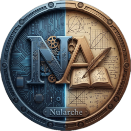
</p>

<h1 align="center">Nularche</h1>
<p align="center"><code>/ˈnʌl.ɑːrk/</code> · <em>nul-ark</em></p>
<p align="center"><b>Local-first, AI-native notes, databases and templates in plain Markdown.</b><br/>
Your notes stay on your computer. Your AI is the one you already pay for.</p>

<p align="center">
  <a href="https://github.com/VerseOfAC92/nularche/releases/latest"><b>Download</b></a> ·
  <a href="#install-from-the-terminal">Terminal install</a> ·
  <a href="#whats-new-in-150">What's new in 1.5</a> ·
  <a href="#features">Features</a> ·
  <a href="#ai-claude-chatgpt-gemini">AI</a> ·
  <a href="#keyboard-shortcuts">Shortcuts</a> ·
  <a href="#development">Development</a> ·
  <a href="#türkçe">Türkçe</a>
</p>

<p align="center">
  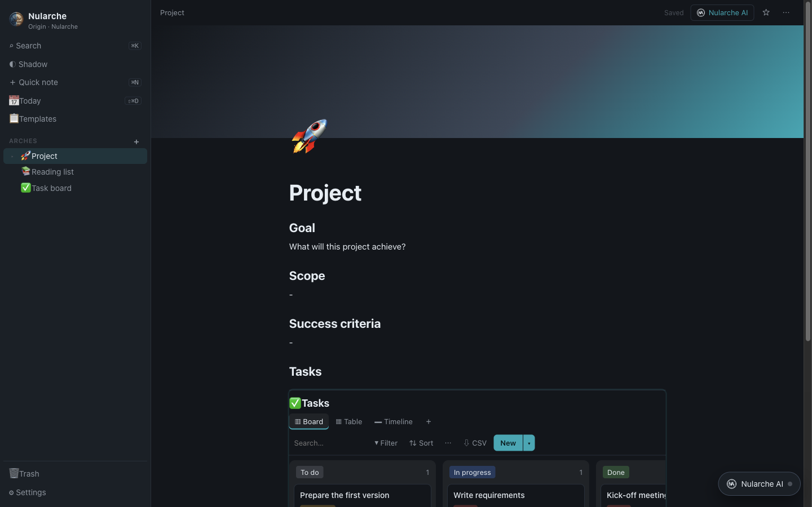
</p>

---

Nularche takes architectural and UX cues from Notion, Microsoft OneNote and Obsidian, but keeps everything as ordinary
Markdown files in a folder you own. There is no account, no cloud and no subscription. AI editing works through the
official Claude, ChatGPT or Gemini app you already use, or for free with a Gemini API key.

The name comes from **Null** (a clean starting point) and **Arche** (first principle, root).

## What's new in 1.5.0

<p align="center">
  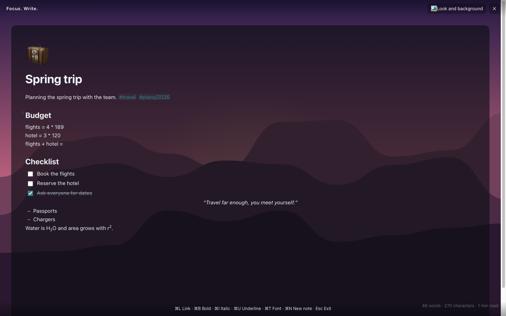
</p>

Nularche 1.5 brings the everyday note-taking features of Apple Notes, the distraction-free writing of a focused writer
app and the linked-notes workflow of Obsidian into Nularche, while your notes stay plain Markdown files. Notes that
use Obsidian syntax keep it when you edit them in Nularche.

**Focused writing**
- **Focus mode** (⇧⌘F / Ctrl+Shift+F): full screen, no sidebar or toolbars. The top and bottom bars appear when you
  move the mouse and fade away while you type. Optional typewriter scrolling and "highlight only the current
  paragraph".
- **Writing backgrounds:** ten landscapes drawn for Nularche (Moonlight, Night Sky, Sunset, Snowy Peaks, Dunes,
  Lavender Hills, Calm Sea, Misty Mountains, Autumn, Pine Forest), ten colour palettes, any custom colour or your own
  picture. Use them in focus mode or on every page.
- **Word counter** under every page: words, characters and reading time, or the counts of the selection.
- **Font and size per page** (⌘T / Ctrl+T), plus bigger/smaller text (⌥⌘= / ⌥⌘−).
- **Link dialog** (⌘L / Ctrl+L) with address checking; ⌘/Ctrl-click opens a link, a plain click lets you edit it.

<p align="center">
  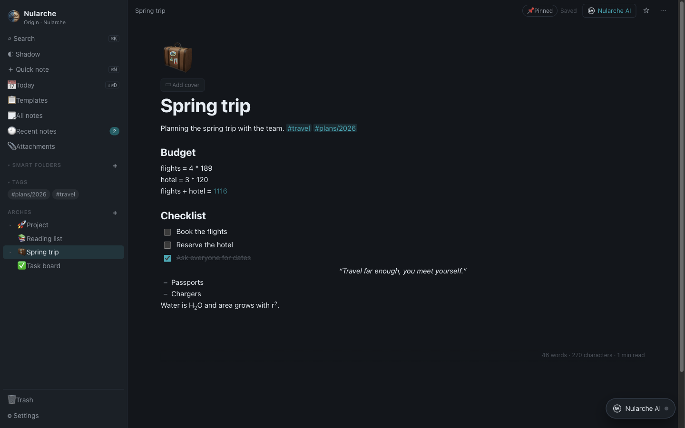
  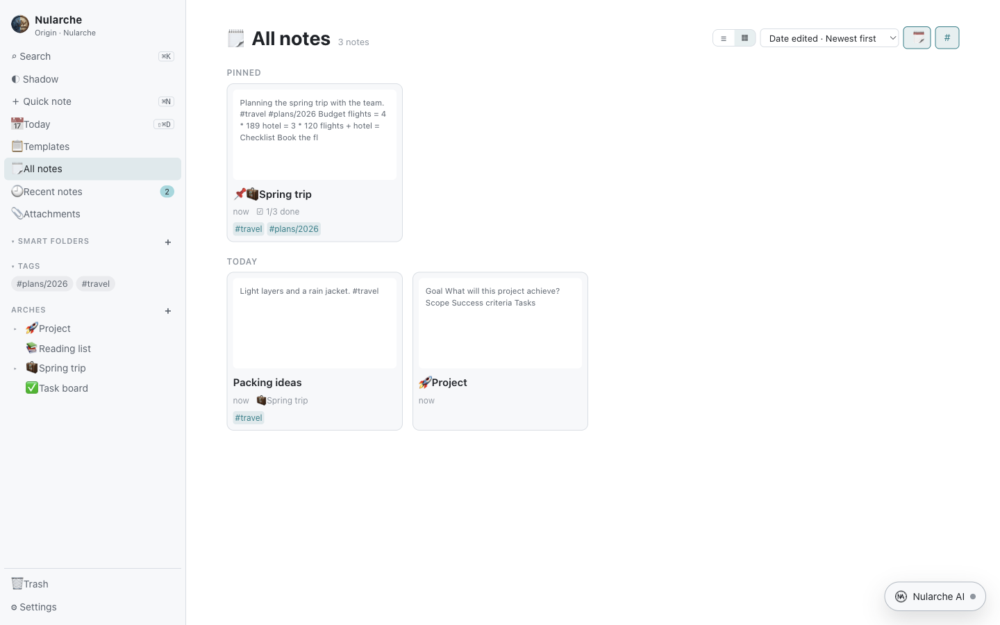
</p>

**Organising and finding**
- **#Tags:** type `#tag` (or `#area/subtag`) anywhere in a note. Tags get their own list in the sidebar, can be
  renamed everywhere at once, and ⌘/Ctrl-click on a tag opens its notes.
- **Smart folders:** saved lists that fill themselves: by tags, date created or edited, checklists (open or done),
  attachments, Arche, pinned or locked. Any Arche can be turned into a smart folder.
- **Note lists:** All notes, Recent notes, a tag, a smart folder or any Arche as a **list** or **gallery** (with a
  preview picture), sorted by date edited, date created or title, grouped by date (Today, Yesterday, Previous 7 days…)
  and with an optional note count. **Pinned** notes stay on top.
- **Attachments browser:** every photo, drawing, recording and file in one place; filter by type, rename (links are
  updated) and jump to the note that uses it.
- **Find and replace** inside a note (⌘F, ⌥⌘F, ⌘G), with Turkish-aware case matching and an option to treat
  ç/c, ş/s… as equal.

**Writing and formatting**
- Paragraph styles (Title, Heading, Subheading, Body, Monostyled), **alignment** (left, centre, right, justify),
  **indent**, **right-to-left** paragraphs, **superscript** and **subscript**, a **dashed list**, upper/lower/title
  case, copy and paste style, and paste and match style (⌥⇧⌘V).
- **Collapsible sections:** fold everything under a heading, or all headings at once.
- **Checklists:** check or uncheck all, move checked items to the bottom (once or always), delete checked items.
- **Math results:** end a line with `=` (`120*3 =`, `rent + fees =`) and Nularche suggests the result (Tab inserts
  it). Lines like `rent = 1500` define variables. A small, safe calculator: no code is ever run.
- **Audio recordings** in a note, with optional **transcription or a summary** through Automatic mode (your own
  Gemini key; the audio goes only to Google, only when you ask).
- **Drawings:** a simple pen, marker and eraser canvas, saved as an editable PNG.
- **Read aloud** with your system voices.

**Security, import and export**
- **Lock a note** with a password. The content is encrypted on your computer (AES-256-GCM, key derived with
  PBKDF2-SHA-256), so the `.md` file holds only ciphertext. Locked notes are hidden from search, export and AI tools;
  *Close all locked notes* locks them again. There is no recovery if you forget the password.
- **Import** Markdown, plain text, HTML and RTF files or whole folders into Shadow (images they reference are copied),
  for example notes exported from Apple Notes. **Copy as Markdown** and **Paste as Markdown**.
- **Export** a page as **Word (.docx)**, **RTF** or **plain text**, in addition to Markdown, HTML and PDF.
- **Print** (⌘P), **open a note in its own window**, **Keep on top**, and **show a note with a light background**
  while the app is dark.
- New **Format** and **View** menus on every platform; all shortcuts are listed with ⌘/ (Ctrl+/).
- The MCP server gains `list_tags` and tag search (`search_nodes` with `tag`), and refuses to read or change locked
  notes.

<p align="center">
  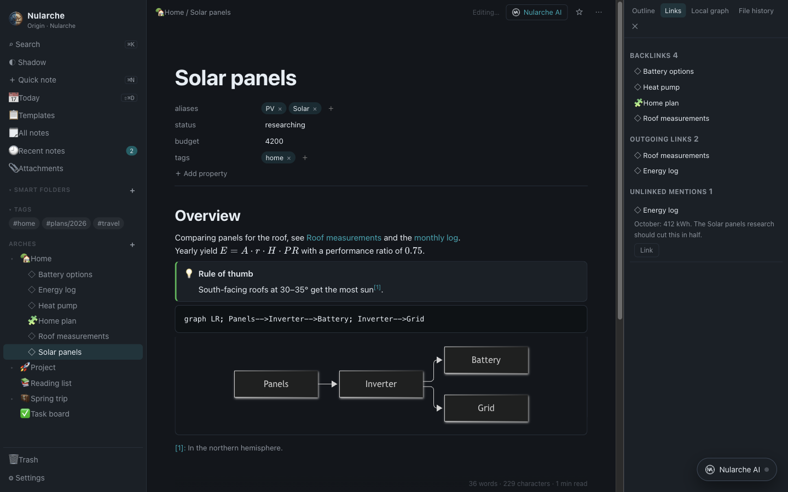
</p>

**Calendar sync (Google and Apple)**
- Sync a database's dated rows both ways with **Google Calendar**, **Apple Calendar (iCloud)** or both: rows with a
  date become events, events become rows, and titles and dates follow changes in either direction. See
  [Calendar sync](#calendar-sync-google-and-apple).

<p align="center">
  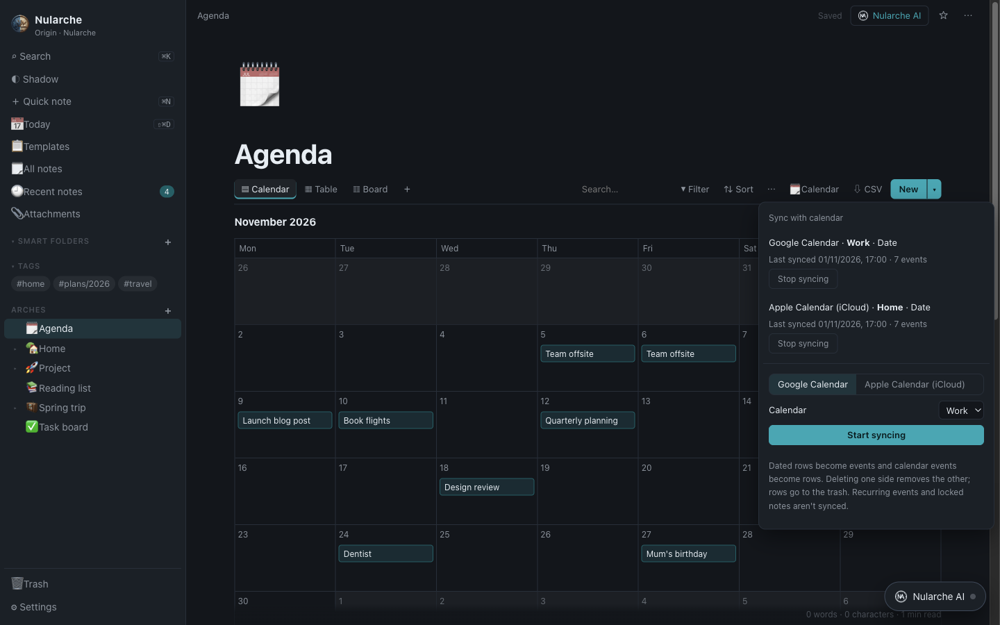
  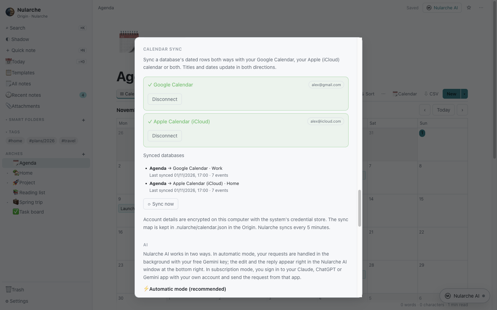
</p>

**Linked notes, the Obsidian way**
- **Wiki links and embeds:** `[[Note]]`, `[[Note#Heading|shown text]]` and `![[Note]]` (shows the note or one of its
  sections inside the page). Links resolve by title, file name or alias; clicking a link to a note that doesn't exist
  yet creates it. Nularche's own links stay ordinary relative Markdown links.
- **Properties:** typed fields at the top of a note (text, list, number, checkbox, date), stored as YAML front matter
  exactly where Obsidian keeps them. `aliases` and `tags` work as in Obsidian. Add one with ⌘; (Ctrl+;).
- **Command palette** (⇧⌘P / Ctrl+Shift+P) runs any command; the **quick switcher** (⌘O / Ctrl+O) opens a note by
  name or alias and creates it if it doesn't exist (⇧↩). **Back and forward** with ⌥⌘← / ⌥⌘→.
- **Graph view** of the whole Origin (filter, orphans, unresolved links, tags) and a **local graph** of the open note.
- **Side panel** (⇧⌘O / Ctrl+Shift+O): **outline**, **backlinks**, **outgoing links**, **unlinked mentions** (turn
  one into a link with a click), local graph and **file history** (a snapshot at most every five minutes while a note
  changes; preview and restore).
- **Canvas:** an infinite board of text, note, web link and group cards joined by arrows, saved in the open
  [JSON Canvas](https://jsoncanvas.org) format inside the note; cards count as links and follow renamed notes.
- **Tabs and workspaces:** open pages in tabs (⌥⌘T new tab, ⌥⌘W close, Ctrl+Tab to switch; ⌘↩ in the quick switcher
  opens in a new tab), and save or load a set of tabs as a named workspace. Nularche reopens the last page, today's
  note or the home page at startup.
- **Page preview:** hold ⌘ (Ctrl) and hover a link to see the note; in reading view, the side panel and backlinks a
  plain hover is enough.

<p align="center">
  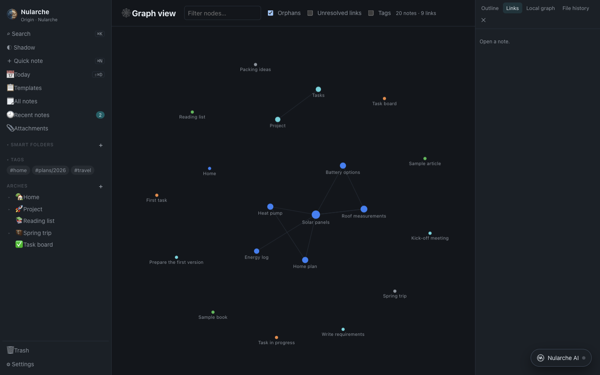
  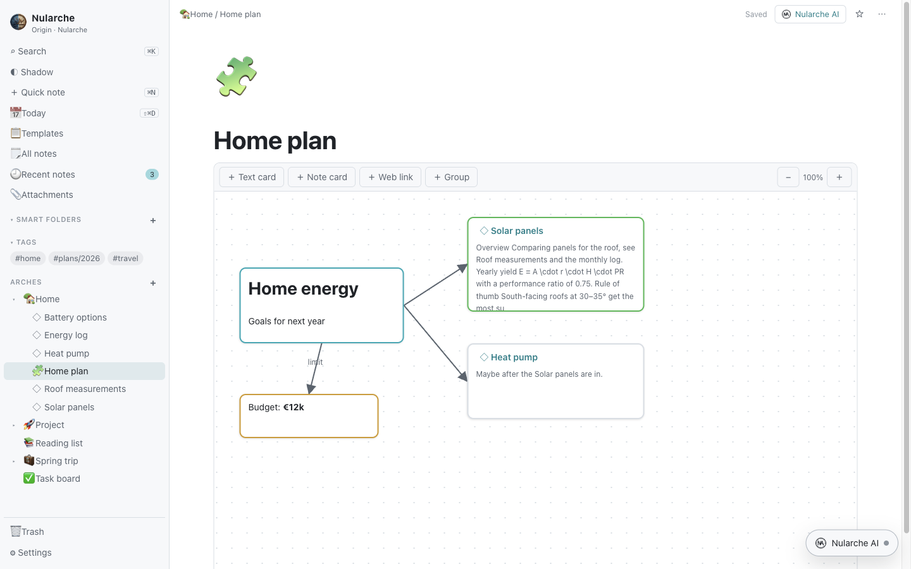
</p>

- **Markdown extras:** LaTeX formulas (`$…$`, `$$…$$`, drawn with KaTeX), **Mermaid** diagrams, footnotes (`[^1]`),
  `%%comments%%` (never published or exported), all Obsidian callout types with titles and fold markers, and moving
  a line or list item with ⌥↑ / ⌥↓.
- **Note composer:** merge a note into another (links are redirected), or extract the selection or a heading's section
  into a new note that is linked in its place. **Templates** fill in `{{title}}`, `{{date}}`, `{{time}}` and formats
  such as `{{date:DD.MM.YYYY}}`, and can be inserted into the current note. **Random note**, **unique note** (time-stamped title), previous/next
  daily note, **reading view** (⌥⌘E), **slides** from a note split by `---`, copy the file path and show it in the
  Finder/file manager.
- **Settings from Obsidian:** your own **hotkeys** for every command (with conflict warnings), **CSS snippets** from
  `.nularche/snippets/`, an **accent colour**, **readable line length**, default view (editing or reading),
  properties shown or hidden, where new notes go, what opens at startup, **auto-pairing** of brackets and quotes, and
  **excluded files**.
- The MCP server gains `get_links` (outgoing links, unresolved targets and unlinked mentions), reads `[[wiki]]` links
  for backlinks, and `update_node` can set properties.

## Download

> **Easiest on a Mac:** paste this into Terminal. It downloads the right build for your Mac, installs it and opens
> it, with no security prompt:
> ```bash
> curl -fsSL https://raw.githubusercontent.com/VerseOfAC92/nularche/main/scripts/install/install.sh | bash
> ```
> Downloading the DMG in a browser works too; see [First launch](#first-launch) for the one-time step.

| System | Installer |
| --- | --- |
| macOS, Apple Silicon (M1–M5) | [`Nularche-macOS-AppleSilicon.dmg`](https://github.com/VerseOfAC92/nularche/releases/latest/download/Nularche-macOS-AppleSilicon.dmg) |
| macOS, Intel | [`Nularche-macOS-Intel.dmg`](https://github.com/VerseOfAC92/nularche/releases/latest/download/Nularche-macOS-Intel.dmg) |
| Windows 10/11, 64-bit | [`Nularche-Windows-x64-Setup.exe`](https://github.com/VerseOfAC92/nularche/releases/latest/download/Nularche-Windows-x64-Setup.exe) |
| Windows 10/11, 32-bit | [`Nularche-Windows-x86-Setup.exe`](https://github.com/VerseOfAC92/nularche/releases/latest/download/Nularche-Windows-x86-Setup.exe) |
| Linux, Debian/Ubuntu (amd64) | [`Nularche-Linux-amd64.deb`](https://github.com/VerseOfAC92/nularche/releases/latest/download/Nularche-Linux-amd64.deb) |

Not sure which Mac you have? Open  → **About This Mac**. "Apple M…" means Apple Silicon; "Intel" means Intel.
Every installer is built, installed and smoke-tested on its own operating system by the
[release workflow](.github/workflows/release.yml) before it is published.

### First launch

The apps are not yet signed with paid Apple and Microsoft developer certificates, so the first launch needs one
extra step:

- **macOS:** the easiest way is the [terminal installer](#install-from-the-terminal), which opens Nularche without
  any warning. If you downloaded the DMG in a browser, macOS 15 or newer shows **"Nularche.app" Not Opened**. Click
  **Done** (not *Move to Bin*), then right away open **System Settings → Privacy & Security** and scroll to the
  **Security** section. Under *Allow applications from* you will see *"Nularche.app" was blocked…*; click
  **Open Anyway** and confirm with your password. You only do this once. The button only appears for a short while
  after the warning, so if it is missing, open Nularche again, click **Done** and go straight back.
  Alternatively, run this once in Terminal:
  ```bash
  xattr -dr com.apple.quarantine /Applications/Nularche.app
  ```
- **Windows:** if SmartScreen shows *Windows protected your PC*, click **More info** → **Run anyway**. Nularche
  installs for your user only; no administrator rights are needed.
- **Linux:** install with `sudo apt install ./Nularche-Linux-amd64.deb`, then start it from the
  applications menu or run `nularche`. No extra step is needed.

On first launch Nularche asks where your notes should live (your **Origin** folder) and offers to connect an AI.
Both can be changed later in **Settings**.

**Updating from 1.0:** install 1.5 over the old version the same way (drag it to Applications on macOS, run the
installer on Windows, `sudo apt install ./Nularche-Linux-amd64.deb` on Linux) or run the terminal installer again.
Your Origin folder, notes and settings stay as they are; 1.0 notes open unchanged.

## Install from the terminal

### Option 1: download the latest release (recommended)

**macOS** (Terminal), picks the Apple Silicon or Intel build automatically:

```bash
curl -fsSL https://raw.githubusercontent.com/VerseOfAC92/nularche/main/scripts/install/install.sh | bash
```

**Linux, Debian/Ubuntu** (Terminal):

```bash
curl -fsSL https://raw.githubusercontent.com/VerseOfAC92/nularche/main/scripts/install/install.sh | bash
```

**Windows** (PowerShell), picks the 64-bit or 32-bit build automatically:

```powershell
irm https://raw.githubusercontent.com/VerseOfAC92/nularche/main/scripts/install/install.ps1 | iex
```

The scripts install only Nularche. You can read them first:
[`install.sh`](scripts/install/install.sh) · [`install.ps1`](scripts/install/install.ps1).

### Option 2: clone with git and build from source

Requirements: [git](https://git-scm.com) and [Node.js 24 or newer](https://nodejs.org) (with npm). The scripts
check for them but do not install them.

**macOS / Linux** (Terminal):

```bash
git clone https://github.com/VerseOfAC92/nularche.git
cd nularche
./scripts/install/build-from-source.sh
```

**Windows** (PowerShell):

```powershell
git clone https://github.com/VerseOfAC92/nularche.git
cd nularche
.\scripts\install\build-from-source.ps1
```

They run `npm ci` and the test suite, build the installer for your machine into `release/` and install it.

## Features

<p align="center">
  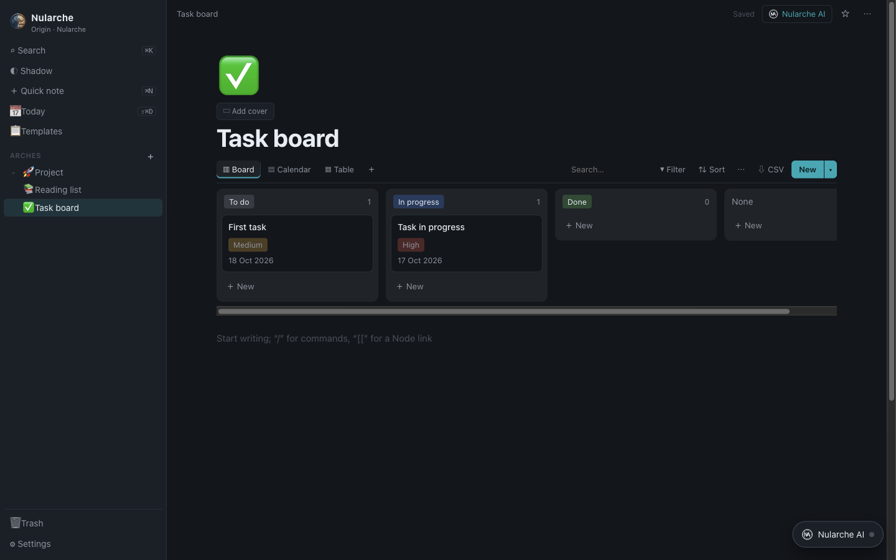
  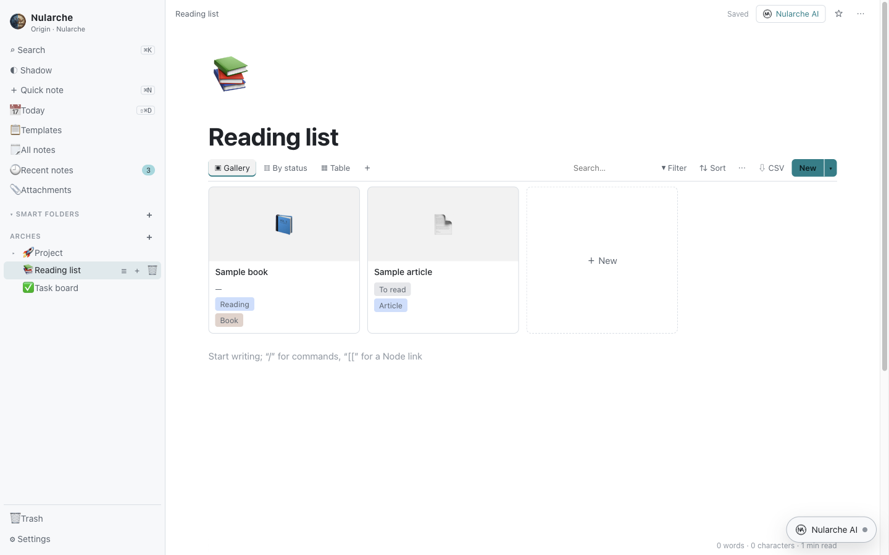
</p>

### Your data, as plain files

- Every page is a Markdown (`.md`) file inside your **Origin** folder. A page with sub-pages lives in its own folder
  (`Project/Project.md`), and images and files go into `Attachments/`.
- Open and edit your notes in any editor (Obsidian, VS Code, TextEdit…) and back them up with Time Machine, iCloud,
  OneDrive or Git.
- **Trash:** deleted pages, with their sub-pages, wait in the Trash and can be restored to their original place.

### Structure

- **Arche:** top-level areas or projects, with unlimited nested pages (**Nodes**) beneath them.
- **Shadow:** an inbox for quick thoughts that do not belong anywhere yet, plus a list of unlinked pages.
- **Daily note:** one click (or a shortcut) opens today's journal page.
- **#Tags, smart folders, pinned notes** and note lists (list or gallery, sorted and grouped by date).
- Drag and drop pages in the sidebar, favourites, emoji icons and cover images.

### Databases

<p align="center">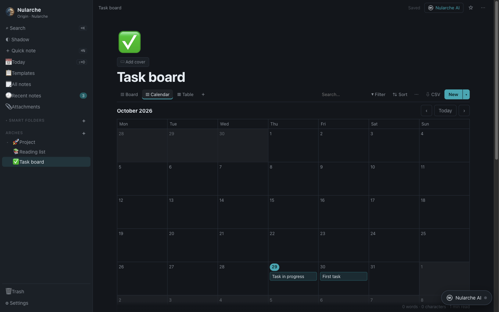</p>

- Six views: **Table, Board (Kanban), List, Gallery, Calendar and Timeline**.
- 15 property types:
  - text, number, date (with ranges) and checkbox;
  - select, multi-select and status;
  - URL, email and phone;
  - relation, rollup and formula;
  - created time and last edited time.
- Filters (all/any), sorting, grouping, search, hidden and resizable columns, and CSV export.
- Drag cards across the board to change their status, or across the calendar to reschedule them.
- Every row is a full page, with its properties on top and free-form notes below.
- Type `/` → **Database** to embed one inside any page.
- Formulas use a small, safe expression language (no code execution), for example
  `if(prop("Done"), "✓", "")` or `dateBetween(prop("Due"), today(), "days")`.

### Calendar sync (Google and Apple)

<p align="center"></p>

Keep a database and a calendar in step: rows with a date become events, events become rows, and titles and dates
follow changes in either direction. One database can sync with a Google calendar, an Apple (iCloud) calendar or both.

1. **Settings → Calendar sync** → connect an account:
   - **Google Calendar:** in [Google Cloud](https://console.cloud.google.com/apis/credentials) enable the *Google
     Calendar API* and create an OAuth client of type **Desktop app**. Paste its client ID and secret into Nularche and
     sign in with Google in the browser. Nularche only asks for access to events and the list of your calendars.
   - **Apple Calendar (iCloud):** create an
     [app-specific password](https://support.apple.com/102654) (Apple Account → Sign-In and Security → App-Specific
     Passwords) and enter it with your Apple ID.
2. Open a database, click **🗓 Calendar** in its toolbar, choose the calendar (and the date property if there are
   several) and click **Start syncing**.

Nularche then syncs every 5 minutes and when you click **Sync now** in Settings.

<p align="center"></p>

- A date without a time becomes an all-day event; a time without an end becomes a one-hour event. Date ranges stay
  ranges.
- If both sides changed since the last sync, the latest edit wins.
- Deleting a row deletes its event. An event deleted in the calendar moves its row to the **trash**, where you can
  restore it. Removing a row's date also takes it off the calendar.
- An event's description is copied into the row's note when the row is created; later edits to notes and descriptions
  are not synced.
- Recurring events and password-locked notes are not synced. Events between one year ago and two years ahead are
  imported.
- **Stop syncing** keeps both the rows and the events.
- Account details are encrypted with the system credential store (Keychain, DPAPI or libsecret) and stay on this
  computer; disconnect them in **Settings → Calendar sync**. The sync map lives with your notes in
  `.nularche/calendar.json`, so moving the Origin to another computer doesn't duplicate events.

### Templates

<p align="center">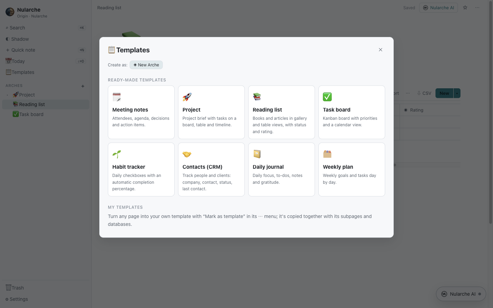</p>

- Eight ready-made templates: Meeting Notes, Project, Reading List, Task Board, Habit Tracker, Contacts (CRM),
  Daily Journal and Weekly Plan.
- Turn any page into your own template. It is copied together with its sub-pages and databases.
- Row templates for databases, and **Duplicate** for any page.

### Writing

- Type `/` for the block menu: headings, lists, to-dos, toggles, quotes, dividers, callouts, tables, code with syntax
  highlighting, images, files and YouTube.
- Bold, italic, underline, strikethrough, highlights, text colours and drag-and-drop block reordering.
- Type `[[` to link another page. Backlinks appear at the bottom, and links and covers update automatically when
  pages are renamed or moved.
- Search everything with a keyboard shortcut. Search is case-insensitive and handles Turkish characters correctly;
  search for `#tag` to find tagged notes.
- Alignment, indent, right-to-left text, superscript/subscript, dashed lists, collapsible sections, find and replace,
  math results, audio recordings and drawings (see [What's new in 1.5.0](#whats-new-in-150)).
- Obsidian-compatible: `[[wiki links]]`, embeds, properties, LaTeX, Mermaid, footnotes, `%%comments%%`, callouts,
  graph view, canvas, command palette and quick switcher.

### Export and publishing

- Export a page as **Markdown (.zip)**, a **self-contained HTML** file, a **PDF**, **Word (.docx)**, **RTF** or
  **plain text**, or print it.
- **Import** Markdown, text, HTML and RTF files or folders (for example from Apple Notes).
- Mark pages with **Publish to web** and generate a **static website** from them (one HTML page per note, navigation,
  images), ready for GitHub Pages or Netlify. Pages you have not marked are never included, and Nularche never
  uploads anything itself.
- **Archives:** back up the whole Origin as `.nla`, or share one page with its attachments as `.nlc`.

### Settings

- **Appearance:** System (the default, which follows your OS), Light or Dark.
- **Language:** English or Turkish. The interface, menus and AI replies switch instantly.
- **Writing:** math results (off, suggest or insert), spell checking, word counter, writing background and focus
  mode options, and import.
- **Origin:** show, open or switch your notes folder.
- **Keyboard shortcuts:** the full list for your operating system.
- **Publishing**, **Archives**, **AI** and **About**.

## AI (Claude, ChatGPT, Gemini)

<p align="center">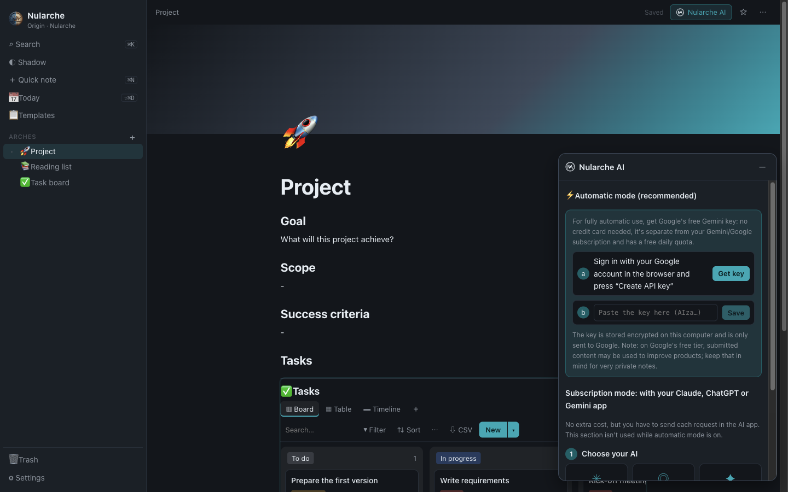</p>

The **Nularche AI** window sits at the bottom right. You can drag it anywhere or minimise it. Open a page and choose
an action: **Fix · Summarise · Expand · To-dos · Link related notes · Translate**. You can also write your own request
or select text to work on just that part. Every AI edit can be undone with one click.

| Mode | How it works | Cost |
| --- | --- | --- |
| **Automatic** | Requests run in the background with a free Gemini API key from Google AI Studio. If a model is busy, Nularche falls back to another. The key is stored encrypted on your computer. | Free tier |
| **Subscription** | Use your own **Claude** (Claude Desktop / Claude Code), **ChatGPT** (desktop app / Codex) or **Gemini** (Antigravity) account. Nularche registers its MCP server with that app in one click and detects when it connects. | Your existing plan; no API fees |

Nularche never sees or stores your AI account credentials. In subscription mode the AI app talks to your notes
through the local `nularche` MCP server, which offers 21 tools: read/search/create/update pages (with properties), Shadow, tags (`list_tags`), links
(`get_backlinks`, `get_links`), databases
(`create_database`, `query_database`, `add_database_row`, `set_row_properties`, `update_database_schema`),
`duplicate_node`, and the Nularche AI request tools.

## Keyboard shortcuts

Press **⌘ /** (macOS) or **Ctrl + /** (Windows, Linux) in the app to see this list.

| Action | macOS | Windows / Linux |
| --- | --- | --- |
| Search | ⌘ K | Ctrl + K |
| Quick note (Shadow) | ⌘ N | Ctrl + N |
| Today's daily note | ⇧ ⌘ D | Ctrl + Shift + D |
| Save now | ⌘ S | Ctrl + S |
| Settings | ⌘ , | Ctrl + , |
| Keyboard shortcuts | ⌘ / | Ctrl + / |
| Capture to Shadow (in the capture box) | ⌘ ↩ | Ctrl + Enter |
| Command menu / page link | `/` · `[[` | `/` · `[[` |
| Bold · Italic · Underline | ⌘ B · ⌘ I · ⌘ U | Ctrl + B · Ctrl + I · Ctrl + U |
| Strikethrough · Inline code · Highlight | ⇧ ⌘ S · ⌘ E · ⇧ ⌘ H | Ctrl + Shift + S · Ctrl + E · Ctrl + Shift + H |
| Undo · Redo | ⌘ Z · ⇧ ⌘ Z | Ctrl + Z · Ctrl + Y |
| Heading 1 / 2 / 3 | ⌥ ⌘ 1 / 2 / 3 | Ctrl + Alt + 1 / 2 / 3 |
| Bulleted · Numbered · To-do list | ⇧ ⌘ 8 · ⇧ ⌘ 7 · ⇧ ⌘ 9 | Ctrl + Shift + 8 · 7 · 9 |
| Quote · Code block | ⇧ ⌘ B · ⌥ ⌘ C | Ctrl + Shift + B · Ctrl + Alt + C |
| Body text · Dashed list | ⌥ ⌘ 0 · ⇧ ⌘ 6 | Ctrl + Alt + 0 · Ctrl + Shift + 6 |
| Superscript · Subscript | ⇧ ⌘ . · ⇧ ⌘ , | Ctrl + Shift + . · Ctrl + Shift + , |
| Align left · centre · right · justify | ⇧ ⌘ L · E · R · J | Ctrl + Shift + L · E · R · J |
| Indent · Outdent | ⌘ ] · ⌘ [ | Ctrl + ] · Ctrl + [ |
| Link · Font and size | ⌘ L · ⌘ T | Ctrl + L · Ctrl + T |
| Bigger · Smaller text | ⌥ ⌘ = · ⌥ ⌘ − | Ctrl + Alt + = · Ctrl + Alt + − |
| Find · Find and replace | ⌘ F · ⌥ ⌘ F | Ctrl + F · Ctrl + Alt + F |
| Next · Previous match | ⌘ G · ⇧ ⌘ G | Ctrl + G · Ctrl + Shift + G |
| Paste and match style | ⌥ ⇧ ⌘ V | Ctrl + Alt + Shift + V |
| Focus mode · Print | ⇧ ⌘ F · ⌘ P | Ctrl + Shift + F · Ctrl + P |
| Insert a math result | Tab | Tab |
| Command palette · Quick switcher | ⇧ ⌘ P · ⌘ O | Ctrl + Shift + P · Ctrl + O |
| Back · Forward | ⌥ ⌘ ← · ⌥ ⌘ → | Ctrl + Alt + ← · Ctrl + Alt + → |
| Side panel (outline, links, history) | ⇧ ⌘ O | Ctrl + Shift + O |
| Add property · Reading view | ⌘ ; · ⌥ ⌘ E | Ctrl + ; · Ctrl + Alt + E |
| Move line up · down | ⌥ ↑ · ⌥ ↓ | Alt + ↑ · Alt + ↓ |
| Clear formatting | ⌘ \ | Ctrl + \ |
| New tab · Close tab · Next tab | ⌥ ⌘ T · ⌥ ⌘ W · ⌃ Tab | Ctrl + Alt + T · Ctrl + Alt + W · Ctrl + Tab |
| Page preview | ⌘ + hover a link | Ctrl + hover a link |

Every command's shortcut can be changed in **Settings → Keyboard shortcuts**.

## Where things are stored

| | macOS | Windows | Linux |
| --- | --- | --- | --- |
| Notes (default Origin) | `~/Documents/Nularche` | `Documents\Nularche` | `~/Documents/Nularche` |
| Settings | `~/Library/Preferences/io.nularche.app` | `%APPDATA%\Nularche\config` | `~/.config/nularche` |
| App data | `~/Library/Application Support/Nularche` | `%LOCALAPPDATA%\Nularche\data` | `~/.local/share/nularche` |

**Uninstall:** delete `Nularche.app` (macOS), use **Settings → Apps** (Windows) or run `sudo apt remove nularche`
(Linux). Uninstalling never deletes your notes.

Uninstalling also keeps your settings, including a saved Gemini API key, so a reinstall picks up where you left off.
Nothing personal is ever stored inside the app itself: every new installation starts with an empty AI setup. To remove
a saved key, use **Settings → AI → Automatic mode → Remove key**. Calendar accounts are removed with **Settings → Calendar sync →
Disconnect**. To reset Nularche completely, quit it and delete the
**Settings** and **App data** folders listed above, for example on macOS:

```bash
rm -rf ~/Library/Preferences/io.nularche.app ~/Library/Application\ Support/Nularche
```

## Glossary

| Term | Meaning |
| --- | --- |
| **Origin** | Your notes folder. |
| **Arche** | A top-level area or project. |
| **Node** | A page. |
| **Shard** | A block inside a page (text, table, image…). |
| **Shadow** | The inbox for quick, not-yet-filed notes. |

## Development

Nularche is TypeScript end to end. Node.js 24 runs the source directly (type stripping), so tests need no build step.

```text
packages/
  core/      Note store (Markdown files, links, layout, trash), databases, formulas, export, archives, AI activity
  server/    Local HTTP API on 127.0.0.1 (Host/Origin checked) used by the UI
  mcp/       The `nularche` MCP server for Claude / ChatGPT / Gemini apps
  web/       React 19 + TipTap 3 interface (Vite)
  desktop/   Electron main process, menus, dialogs, AI connections, installers
scripts/     build, packaging (dist-mac / dist-win), tests (e2e, MCP, packaged smoke), install scripts
```

```bash
git clone https://github.com/VerseOfAC92/nularche.git && cd nularche
nvm use            # Node.js version from .nvmrc
npm ci
npm test           # core (node:test) + UI (vitest)
npm run typecheck
npm run mcp:smoke  # MCP server end to end
npm start          # browser version at http://localhost:5178 (set NULARCHE_ORIGIN to choose a folder)
npm run desktop    # run the desktop app from source
npm run e2e        # desktop end-to-end test with a temporary home folder
```

Building installers:

| Command | Output (`release/`) |
| --- | --- |
| `npm run dist:mac` | `Nularche-macOS-AppleSilicon.dmg`, `Nularche-macOS-Intel.dmg` |
| `npm run dist:win` | `Nularche-Windows-x64-Setup.exe`, `Nularche-Windows-x86-Setup.exe` |
| `npm run dist:linux` | `Nularche-Linux-amd64.deb` |
| `npm run smoke:packaged -- <app executable>` | Opens an installed build with a temporary profile and checks the UI, storage, API and MCP server |

The 32-bit Windows installer is built with Electron 43, the newest release line that still ships 32-bit Windows
binaries; all other builds use Electron 44.

**Releasing:** bump `version` in `package.json`, add a `## <version>` section to `CHANGELOG.md`, then push a tag
(`git tag v1.0.1 && git push --tags`). The release workflow builds, installs and tests every installer, and publishes
them only if all the tests pass.

Contributions are welcome: open an issue or a pull request. Please keep notes as plain Markdown, keep the app
local-first, and add tests for behaviour changes.

## Licence

[MIT](LICENSE) © 2026 VerseOfAC92

---

## Türkçe

**Nularche**, notlarınızı kendi bilgisayarınızda düz Markdown dosyaları olarak tutan, yapay zekâ destekli bir not ve
bilgi yönetimi uygulamasıdır. Veritabanları (tablo, pano, takvim, galeri, liste, zaman çizelgesi), şablonlar, günlük
not, Çöp, statik site yayınlama ve Claude / ChatGPT / Gemini entegrasyonu içerir. Arayüz Ayarlar'dan Türkçeye
alınabilir.

### 1.5.0'daki yenilikler

Apple Notlar'ın gündelik not özellikleri, odaklı yazma uygulamalarının dikkat dağıtmayan yazma deneyimi ve Obsidian'ın
bağlantılı not yaklaşımı artık Nularche'de; notlarınız yine düz Markdown dosyası olarak kalır. Obsidian sözdizimiyle
yazılmış notlar Nularche'de düzenlenirken bozulmaz.

- **Odak modu** (⇧⌘F / Ctrl+Shift+F): tam ekran, kenar çubuğu ve araçlar gizli; fare hareket edince bilgi çubukları
  belirir. **10 manzara** (Ay Işığı, Gece Göğü, Gün Batımı, Karlı Zirveler, Kum Tepeleri, Lavanta Tepeleri, Sakin
  Deniz, Sisli Dağlar, Sonbahar, Çam Ormanı), **10 renk paleti**, özel renk ya da kendi görseliniz; daktilo kaydırması
  ve yalnızca yazılan paragrafı vurgulama.
- **Sözcük sayacı**, sayfa başına **yazı tipi ve boyut** (⌘T), **bağlantı penceresi** (⌘L).
- **#Etiketler**, **akıllı klasörler**, **notu iğneleme**, **liste/galeri görünümü**, tarihe göre **sıralama ve
  gruplama**, **Son notlar** ve **Ekler** tarayıcısı.
- **Bul ve değiştir** (⌘F, ⌥⌘F), **paragraf stilleri**, **hizalama**, **girinti**, **sağdan sola yazma**, **üs/indis**,
  **tire işaretli liste**, **harf dönüşümleri**, **stili kopyala/yapıştır**, **bölümleri daraltma**.
- **Yapılacaklar:** tümünü işaretle/kaldır, işaretlileri en alta taşı ya da sil.
- **Matematik sonuçları:** satırı `=` ile bitirin (`120*3 =`, `kira + aidat =`); sonuç önerilir, Tab ile eklenir.
- **Ses kaydı** (isteğe bağlı Gemini ile yazıya dökme/özet), **çizim**, **sesli okuma**.
- **Notu parola ile kilitleme** (AES-256, bilgisayarınızda şifrelenir; parola unutulursa içerik kurtarılamaz).
- **Takvim eşitleme:** bir veritabanının tarihli satırlarını **Google Takvim**, **Apple Takvim (iCloud)** ya da ikisiyle
  birden iki yönlü eşitleyin; tarihli satırlar etkinlik, etkinlikler satır olur, başlık ve tarih iki yönde güncellenir.
  **Ayarlar → Takvim eşitleme** bölümünden hesabı bağlayın (Google için Google Cloud'da oluşturduğunuz "Masaüstü
  uygulaması" OAuth istemcisi, Apple için uygulamaya özel parola), sonra veritabanı araç çubuğundaki **🗓 Takvim**
  düğmesinden takvimi seçin. Silinen etkinliğin satırı çöpe taşınır; yinelenen etkinlikler ve kilitli notlar eşitlenmez.
  Ayrıntılar ve kurulum adımları: [Calendar sync](#calendar-sync-google-and-apple).
- **İçe aktarma** (Markdown, metin, HTML, RTF; Apple Notlar dışa aktarımları dahil), **Markdown olarak
  kopyala/yapıştır**, **Word (.docx)**, **RTF** ve **düz metin** olarak dışa aktarma, **yazdırma**, **notu ayrı
  pencerede açma**, **en üstte tutma**, **notu açık arka planla gösterme**.
- Yeni **Biçim** ve **Görüntü** menüleri; MCP sunucusunda `list_tags` ve etikete göre arama.

**Obsidian'dan gelenler**
- **Wiki bağlantıları ve gömme:** `[[Not]]`, `[[Not#Başlık|görünen ad]]`, `![[Not]]`; başlık, dosya adı ya da takma
  adla çözülür, var olmayan nota tıklayınca not oluşturulur.
- **Özellikler (Properties):** notun başında metin, liste, sayı, onay kutusu ve tarih alanları (YAML frontmatter;
  `aliases` ve `tags` Obsidian'daki gibi). ⌘; ile özellik ekleyin.
- **Komut paleti** (⇧⌘P), **hızlı geçiş** (⌘O; yoksa notu oluşturur), **geri/ileri** (⌥⌘← / ⌥⌘→).
- **Grafik görünümü** ve **yerel grafik**; **kenar paneli** (⇧⌘O): ana hat, geri bağlantılar, giden bağlantılar,
  **bağlantısız anılışlar** (tek tıkla bağlantıya çevirme) ve **dosya geçmişi** (önizleme ve geri yükleme).
- **Tuval (Canvas):** metin, not, web bağlantısı ve grup kartları, oklarla bağlantılar; açık JSON Canvas biçiminde
  notun içinde saklanır.
- **Sekmeler ve çalışma alanları:** sayfaları sekmelerde açın (⌥⌘T yeni, ⌥⌘W kapat, Ctrl+Tab geçiş), açık sekmeleri
  adlandırılmış çalışma alanı olarak kaydedip açın; açılışta son sayfa, bugünün notu ya da ana sayfa gelir.
- **Sayfa önizlemesi:** ⌘ basılıyken bir bağlantının üzerine gelince notun içeriği görünür.
- **Markdown ekleri:** LaTeX formüller (`$…$`, `$$…$$`), **Mermaid** diyagramları, dipnotlar, `%%yorumlar%%`
  (yayımlanmaz), tüm Obsidian kutu türleri, satır taşıma (⌥↑ / ⌥↓).
- **Şablon değişkenleri:** `{{title}}`, `{{date}}`, `{{time}}`, `{{date:DD.MM.YYYY}}` gibi; şablonu açık nota ekleme.
- **Not düzenleyici:** notları birleştirme, seçimi ya da başlık bölümünü yeni nota çıkarma; **rastgele not**,
  **benzersiz not**, önceki/sonraki günlük not, **okuma görünümü** (⌥⌘E), notu **sunum** olarak gösterme, dosya yolunu
  kopyalama ve Finder'da gösterme.
- **Ayarlar:** her komut için **kendi kısayolunuz**, `.nularche/snippets/` içindeki **CSS parçacıkları**, **vurgu
  rengi**, **okunabilir satır uzunluğu**, varsayılan görünüm, yeni notların yeri, açılış sayfası, **parantezleri otomatik
  kapatma** ve **hariç tutulan dosyalar**.
- MCP sunucusunda `get_links` aracı; `update_node` özellik de yazabilir.

- **İndirme:** yukarıdaki [Download](#download) tablosundan sisteminize uygun dosyayı seçin.
- **1.0'dan güncelleme:** 1.5'i eskisinin üzerine aynı şekilde kurun (macOS'ta Uygulamalar klasörüne sürükleyin,
  Windows'ta kurulumu çalıştırın, Linux'ta `sudo apt install ./Nularche-Linux-amd64.deb`) ya da terminal kurulumunu
  yeniden çalıştırın. Origin klasörünüz, notlarınız ve ayarlarınız olduğu gibi kalır.
- **Terminalden kurulum (macOS / Linux):**
  `curl -fsSL https://raw.githubusercontent.com/VerseOfAC92/nularche/main/scripts/install/install.sh | bash`
- **Terminalden kurulum (Windows PowerShell):**
  `irm https://raw.githubusercontent.com/VerseOfAC92/nularche/main/scripts/install/install.ps1 | iex`
- **Git ile kaynaktan:** `git clone https://github.com/VerseOfAC92/nularche.git`, sonra macOS/Linux'ta
  `./scripts/install/build-from-source.sh`, Windows'ta `.\scripts\install\build-from-source.ps1`.
