<p align="center">
  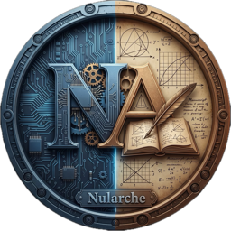
</p>

<h1 align="center">Nularche</h1>
<p align="center"><code>/ˈnʌl.ɑːrk/</code> · <em>nul-ark</em></p>
<p align="center"><b>Local-first, AI-native notes, databases and templates in plain Markdown.</b><br/>
Your notes stay on your computer. Your AI is the one you already pay for.</p>

<p align="center">
  <a href="https://github.com/VerseOfAC92/nularche/releases/latest"><b>Download</b></a> ·
  <a href="#install-from-the-terminal">Terminal install</a> ·
  <a href="#whats-new-in-300">What's new in 3.0</a> ·
  <a href="#features">Features</a> ·
  <a href="#ai-claude-chatgpt-gemini">AI</a> ·
  <a href="#keyboard-shortcuts">Shortcuts</a> ·
  <a href="#development">Development</a> ·
  <a href="#türkçe">Türkçe</a>
</p>

<p align="center">
  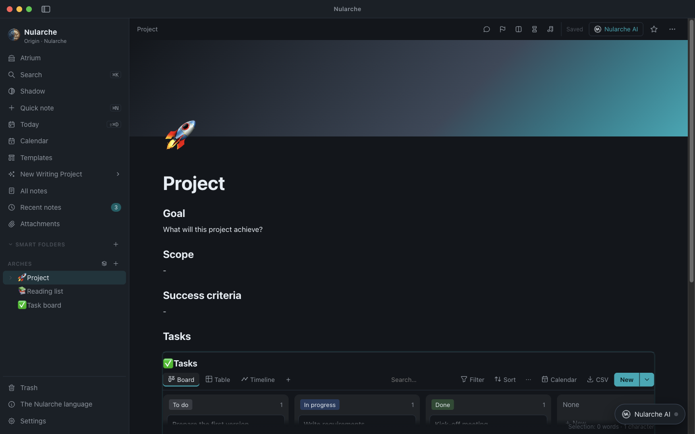
</p>

---

Nularche takes architectural and UX cues from Notion and Microsoft OneNote, but keeps everything as ordinary
Markdown files in a folder you own. There is no account, no cloud and no subscription. AI editing works through the
official Claude, ChatGPT or Gemini app you already use, or for free with a Gemini API key.

The name comes from **Null** (a clean starting point) and **Arche** (first principle, root).

## What's new in 3.0.0

Nularche 3.0 is about **trust** and **using what you know**. Your notes get stronger protection: a whole Arche can be
encrypted with one password, open locked notes close themselves, and encrypted snapshots let you bring back any note,
or the whole Origin, from a past moment. For research and writing there is a bibliography with citations, a PDF reader
with highlights that turn into notes, block links and embeds, and a readability score. And your knowledge starts working
for you: live queries inside notes, flashcards scheduled with spaced repetition, and automations that run on a schedule.
Every new part has its own Nularche name, explained in the Nularche language window.

<p align="center">
  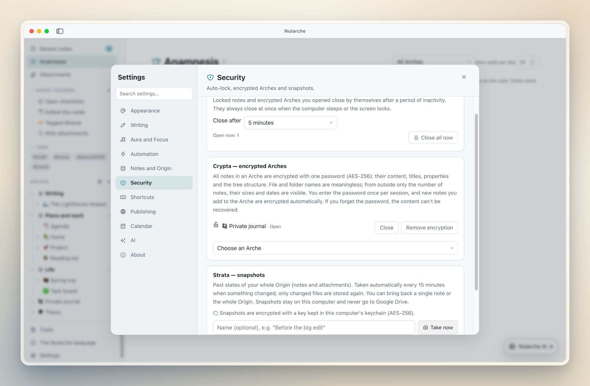
</p>

**Security**

- **Crypta (encrypted Arche):** in **Settings → Security**, encrypt every note in an Arche with one password
  (AES-256-GCM, key derived with PBKDF2, 600,000 rounds). Enter it once per session and all of the Arche's notes open;
  new notes you add to it are encrypted automatically. Titles, properties and the tree stay visible. The password is
  never stored, so it can't be recovered.
- **Custos (auto-lock):** open locked notes and Crypta Arches close by themselves after a period without activity
  (1 to 60 minutes, 5 by default), and always at once when the computer sleeps or the screen locks.
- **Strata (snapshots):** your whole Origin, notes and attachments, is saved as a snapshot every 15 minutes when
  something changed, and any time you press **Take now**. Snapshots are content-addressed and incremental (an unchanged
  file is never stored twice) and encrypted with a key kept in your system keychain. See what changed, preview a note,
  bring back one file or restore the whole Origin; a snapshot of the current state is taken first, so a restore can be
  undone. Snapshots stay on this computer and never go to Google Drive. Locking a note removes its unencrypted versions
  from every snapshot.
- **A sealed local connection:** the app's local server now accepts requests only from Nularche's own windows, through a
  per-launch secret that page scripts can't read, and the interface runs under a strict content security policy.
  HTML inside notes is cleaned with an allow-list both in the app and in exported and published pages, so imported or
  pasted content can't run scripts.

**Research and writing**

<p align="center">
  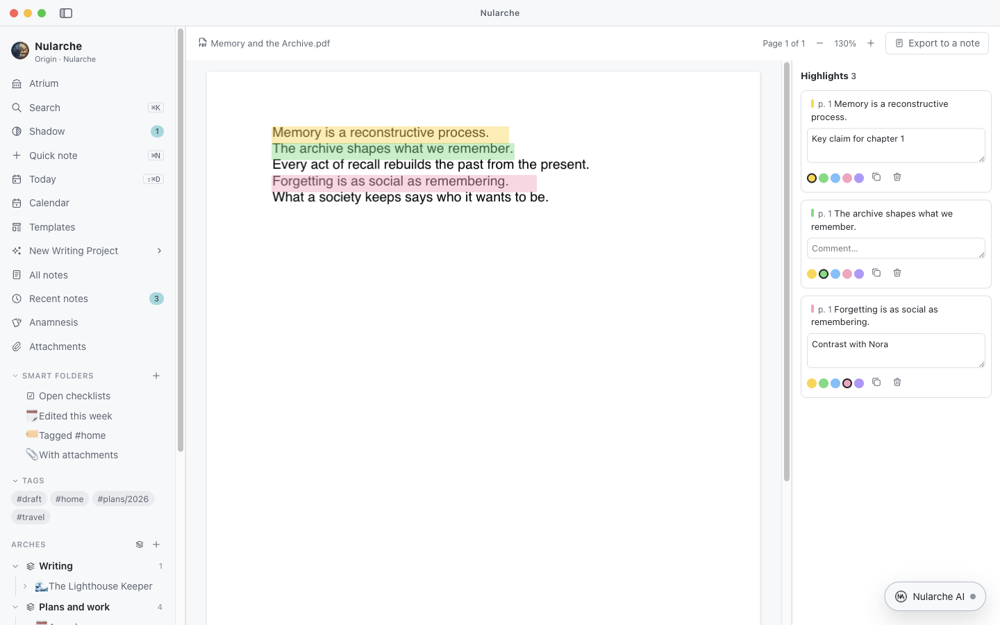
  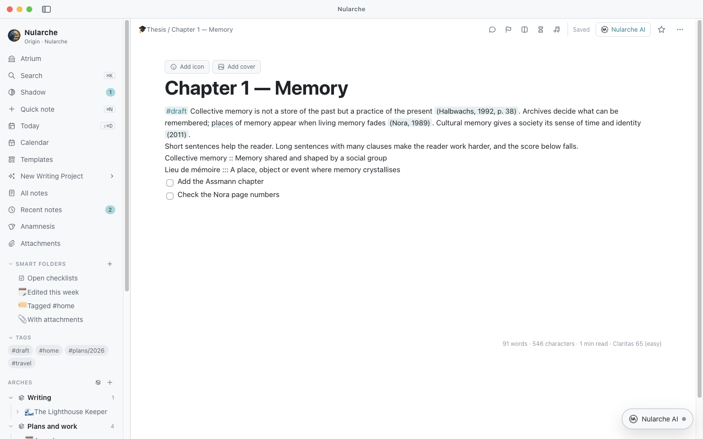
</p>

- **Fontes (bibliography and citations):** choose a BibTeX (`.bib`) or CSL-JSON file in **Settings → Writing**. Type
  `[@` in a note to pick a source; `[@key, p. 12]` adds a page, `[-@key]` leaves out the author and `[@a; @b]` cites
  several. Citations show as chips formatted in your style. On export (HTML, Word, RTF, the published site and a whole
  Codex) they are written out and a bibliography is added at the end, or where you put a `{{bibliography}}` line.
  Styles: APA 7, Chicago (author-date), MLA 9 and IEEE.
- **Lectio (PDF reader):** open a PDF from **Attachments** or from a link in a note. Select text and pick one of five
  colours to highlight it, add comments, then **Export to a note**: every highlight becomes a quote with a link that
  opens the PDF at that page. New highlights are added to the same note. Highlights live in
  `.nularche/annotations/` and sync with your notes.
- **Tessera (block links and embeds):** right-click a paragraph and **Copy block link**: the paragraph gets a short
  `^id` and `[[Note#^id]]` is copied. The link opens the note at that paragraph; `![[Note#^id]]` shows the paragraph
  itself in another note. Headings work the same way. Exports and the published site write embedded text out in full.
- **Claritas (readability):** next to the word count, a 0–100 score (higher is easier), using the Ateşman formula for
  Turkish and Flesch reading ease for English. Hover it for words per sentence and syllables per word.

**Using what you know**

<p align="center">
  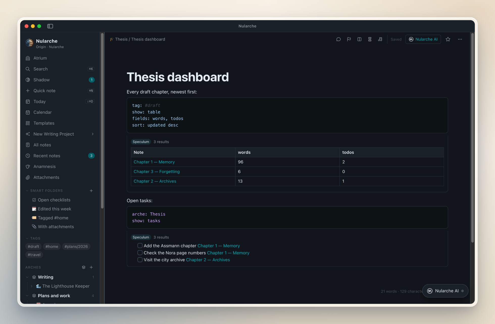
  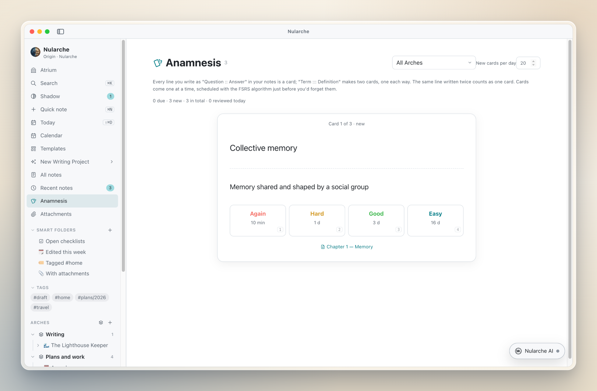
</p>

- **Speculum (live query):** type `/` and choose **Speculum** to add a query block. Lines such as `tag: #draft`,
  `arche: Thesis`, `where: status = Open`, `where: updated >= -7d`, `sort: updated desc`, `show: table` and
  `fields: status, due` list matching notes as a list, table, count or open tasks, and the result updates as your notes
  change. Ticking a task in the result ticks it in its note.
- **Anamnesis (flashcards):** every `Question :: Answer` line in your notes is a card; `Term ::: Definition` makes two,
  one each way. **Anamnesis** in the sidebar asks them one at a time, scheduled with the FSRS algorithm so each card
  comes back just before you'd forget it. Space shows the answer, 1–4 rates it, and each button shows when the card
  returns. Pick a deck by Arche and how many new cards a day. Cards in encrypted notes appear while the note or its
  Crypta Arche is open.
- **Vigil (scheduled automations):** in **Settings → Automation**, run something every day, week or month at a set time:
  give **Nularche AI** a task (for example "summarise last week's notes into a new note") or let Nularche write a
  **digest note** itself (new and updated notes, notes with open tasks, cards due). Results appear in a Vigil card in
  the **Atrium** and upcoming runs in the **Calendar**. A run missed while the app was closed happens once when it
  opens, and two computers sharing an Origin don't run the same job twice.

<p align="center">
  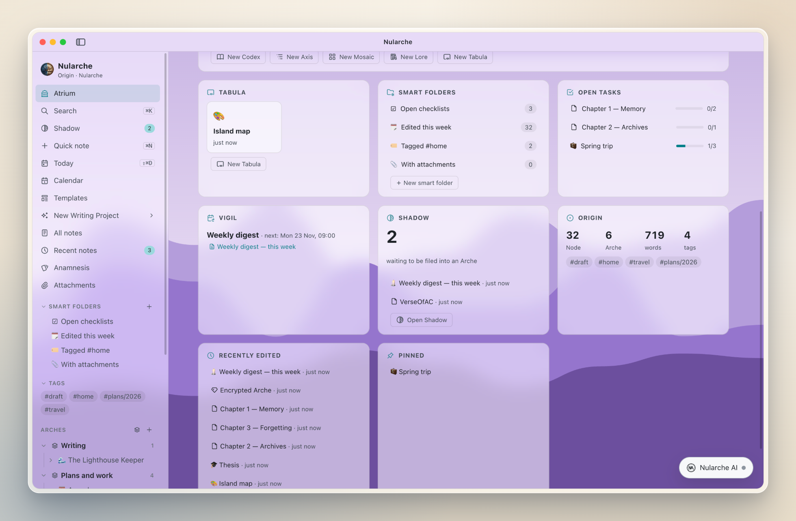
</p>

## What's new in 2.5.0

Nularche 2.5 adds **Tabula**, a whiteboard that sits over your writing background, a sidebar that hides completely,
a richer **Atrium**, and a Nularche AI that can no longer hang and never edits a note unless you ask it to.
It also brings **Nularche Font**, Nularche's own handwriting typeface, **Archipelagos** that group your Arches, and
your smart folders in the Atrium. A new **Calendar** page shows your Google and Apple calendars with every detail
without turning events into notes, your notes can sync through **Google Drive** (optionally end-to-end encrypted),
titles take formatting, and the whole interface got a careful visual pass.

<p align="center">
  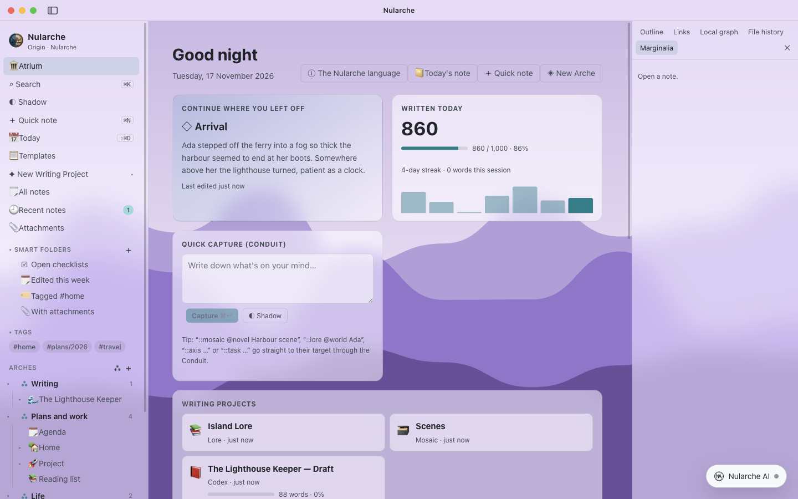
</p>

- **Atrium** (home): where you left off, today's words against your goal with a seven-day chart and streak, quick
  capture, your writing projects and Tabula boards, open tasks with progress, the Shadow inbox, an Origin summary with
  your most used tags, a note to rediscover each day, recently edited and pinned notes. A **Smart folders** card lists
  each smart folder with its note count and creates new ones.

<p align="center">
  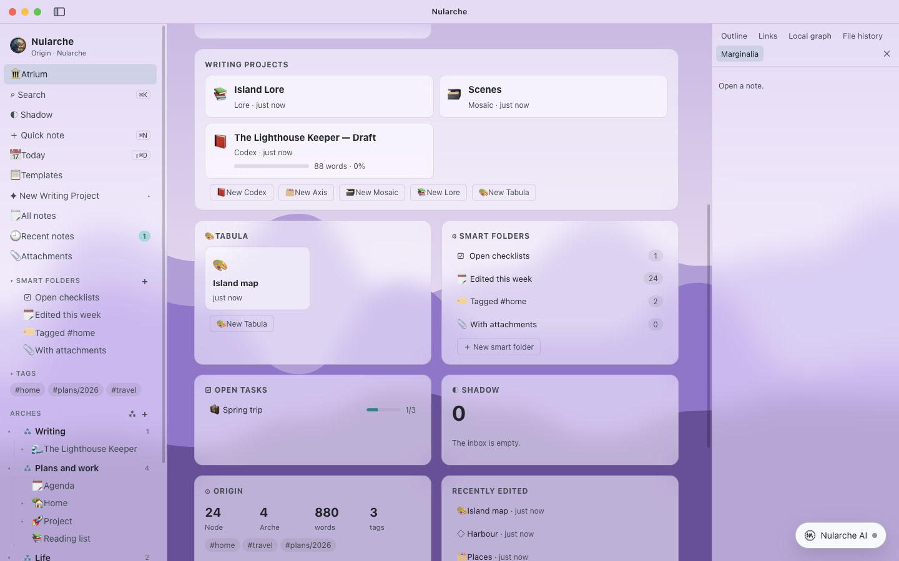
</p>

**Calendar**

<p align="center">
  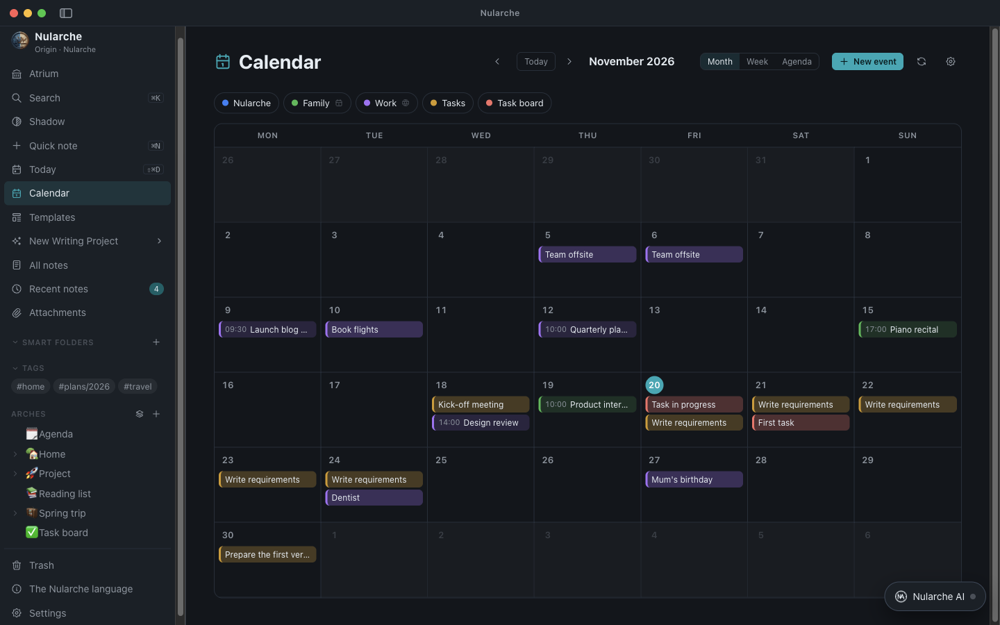
  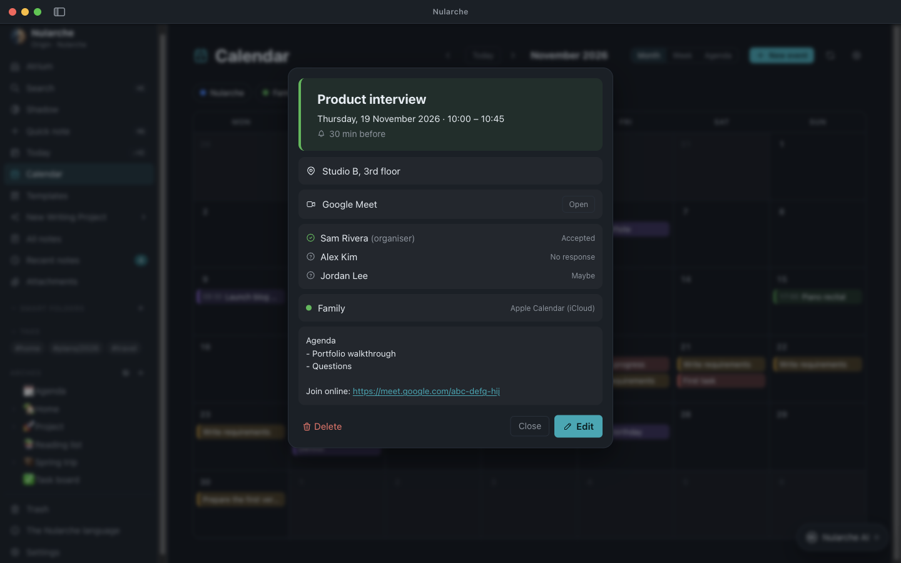
</p>

- **Calendar page** (sidebar or ⇧⌘K): month, week (hour grid with a now line) and agenda views. It shows the local
  **Nularche** calendar, the Google and Apple (iCloud) calendars you turn on, and every database with a date property.
  Each calendar has a chip to show or hide it.
- **No notes from calendars:** turning a calendar on in **Settings → Calendar** only shows it. Its events are kept in
  `.nularche/calendar-events.json`, not as notes or an Arche. Changes made on the Calendar page go straight to Google
  or iCloud. Syncing a database with a calendar is still available from the database's **Calendar** button.
- **Full event details:** click an event to see its time, alert, location, meeting link (Teams, Zoom, Meet or Webex,
  with an **Open** button), the organiser and every attendee with their reply, and the notes with clickable links.
- **New events with details:** title, date and time or all day, location, link, alert and notes, saved to the calendar
  you pick. Editing an invitation changes only the fields you touched, so attendees and other details stay intact.
  Recurring events are view-only.

**Storage and Google Drive**

<p align="center">
  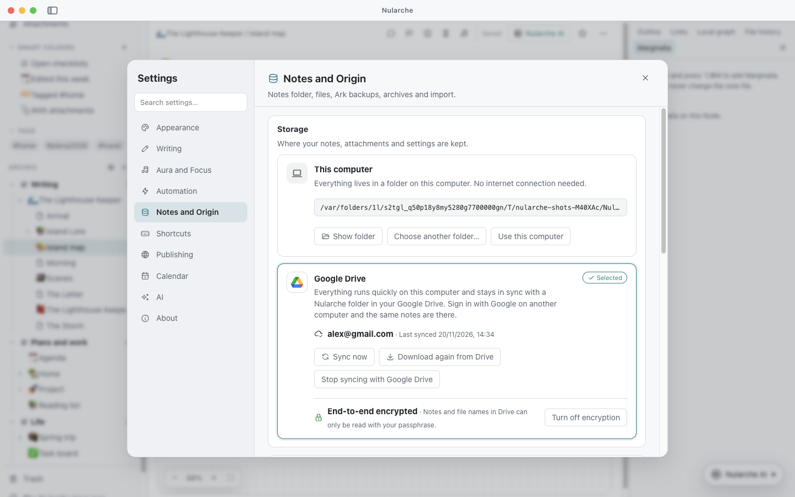
</p>

- **Choose where your notes live** on first launch, in Nularche's own window instead of a system dialog: **this
  computer** or **Google Drive**. Change it any time in **Settings → Notes and Origin**.
- **Google Drive** connects with one click (**Continue with Google**); nobody has to create API keys. Nularche asks only
  for access to the Nularche folder it creates and can't see your other files. The folder on your computer stays the
  working copy, so Nularche is fast and works offline; it syncs both ways with Drive within seconds, every minute and
  when you quit. Sign in on another computer and the same notes are there.
- **Only your content syncs:** notes, attachments, settings, Marginalia, Epochs and CSS snippets. Automatic version
  history, Nularche AI records and the calendar cache stay on each computer.
- **Locked notes stay locked in Drive:** locking a note deletes its unencrypted earlier versions and Epochs, and in
  Drive the old file is deleted for good (with Drive's own version history) before the encrypted note is uploaded.
- **Optional end-to-end encryption:** encrypt the copy in Drive with your passphrase (AES-256-GCM); file names are
  hidden too and no one, Google included, can read them. Your other computers ask for the passphrase once.
- **Two-way safety:** if the folder on your computer suddenly empties, nothing is deleted from Drive; Nularche pauses and
  offers **Restore from Drive**. **Download again from Drive** brings everything back at any time; changes made in two
  places at once are kept as a "conflict" copy instead of being lost.
- **Google Calendar** also connects with one click now.

**Writing and editing**

- **Formatted titles:** select part of a title for bold, italic, underline, strike, highlight and colour (from the
  selection bar or the right-click menu). The plain title still names the file.
- **Right-click** shows Nularche's own options (formatting, links, Marginalia; shape options on Tabula; open, add and
  move in the sidebar) together with the system's (spelling suggestions, Look Up, cut, copy, paste, Share).
- **Tab** indents in notes (and nests list items); Shift-Tab outdents. In tables Tab still moves between cells.
- **Default text size** in Settings → Writing, next to the default writing font.
- **Table column widths** you set by dragging are saved with the note and come back when you open it.
- The writing hint only shows in an empty note.

**Look**

- Every menu, toolbar, panel and dialog uses one set of line icons instead of emoji and symbols; icons you give your
  own notes stay as they are.
- Menus and dialogs over a background use solid frosted glass so text stays readable; spacing, alignment and focus
  states were tidied across the app, including Tabula's shape library and format panel.

**Tabula (whiteboard)**

<p align="center">
  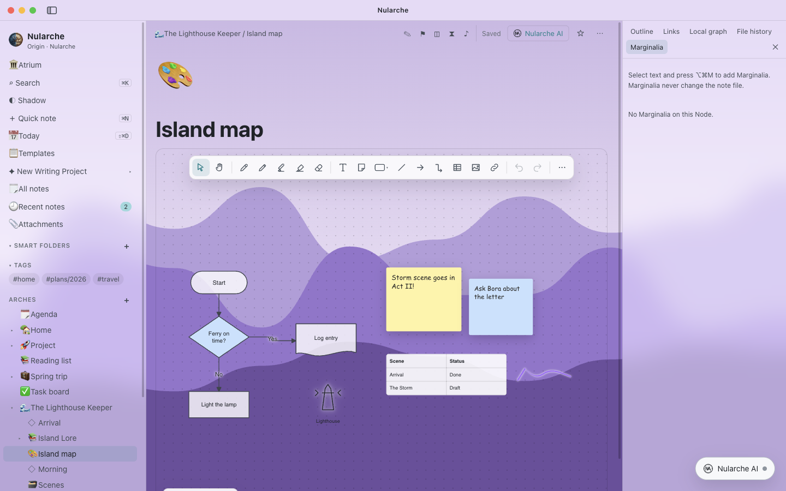
  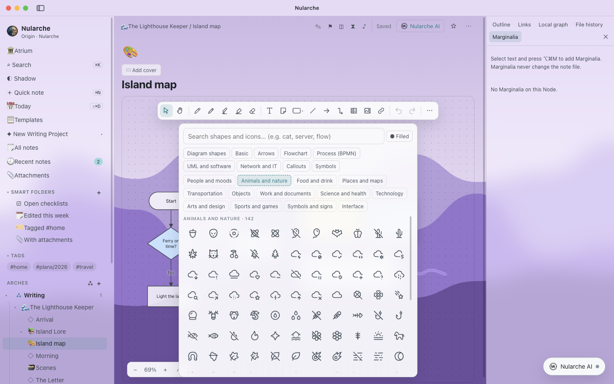
</p>

- **New Tabula** in *New Writing Project*, the Atrium, the `/` menu and File → New Writing Project. The board is
  stored in the note as a JSON block; images are files in your Origin.
- **Drawing:** pen, pencil, marker and highlighter (pressure-sensitive with a stylus), object eraser, any colour and
  width.
- **Content:** sticky notes, text boxes, tables (Tab moves between cells), images (insert, paste or drag in), and cards
  that link to a note.
- **Shapes:** over 130 diagram shapes in eight groups: basic, arrows, flowchart, process (BPMN), UML and software,
  network and IT, callouts and symbols. Plus about 4,800 icons in thirteen groups (people, animals and nature, food,
  places, transport, objects, work, science and health, technology, arts, sports, symbols and interface), in outline
  or filled style. Search works in English and for common Turkish words.
- **Connectors:** lines, arrows and elbow connectors with six end styles. Drag from the dots around a selected shape to
  connect it; connected lines follow when shapes move. Lines can carry a label.
- **Editing:** move, resize, rotate (Shift snaps to 15°), alignment guides, snap to grid, group, lock, layer order,
  align and distribute, flip, duplicate (Alt-drag or ⌘D), copy and paste, undo and redo. Fill, stroke, dash, opacity,
  shadow, font, size, style and alignment for text.
- **Board:** dots, grid, lines or none; transparent by default so the writing background shows through, or a solid
  colour. Zoom with pinch or ⌘ + scroll, pan with two fingers, Space-drag or the hand tool. Export to **PNG** or
  **SVG**.
- Free text and drawings get a soft outline so they stay readable over busy backgrounds.

- Works at every window size: the toolbar wraps onto a second row in narrow windows and the format panel can be
  collapsed with ›.
- Text uses every font available for notes: the seven bundled fonts (including Nularche Font), the system fonts,
  sans, serif, mono and handwriting.

**Nularche Font**

- Nularche now has its own typeface: **Nularche Font**, a handwriting font made for Nularche. Pick it as the writing
  font for all notes (Settings), as the font of a single note, or for text, sticky notes and shapes on a Tabula board.
  It covers the Turkish alphabet, digits and common punctuation and symbols (– — … “ ” « » ₺ € $), ships with the
  app and works offline.

<p align="center">
  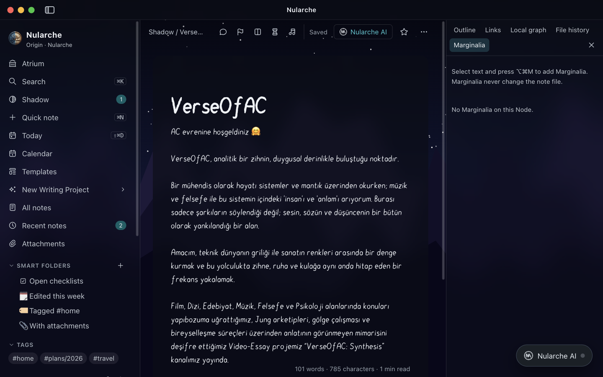
</p>

**Window**

- **Archipelago (group your Arches):** press the group button (stacked layers) next to *Arches* in the sidebar to
  create a group such as Work or School. Add an Arche with its own group button or by dragging it onto the group; drag inside a group to reorder.
  A group can be collapsed, renamed or removed (its Arches stay), and its **+** creates a new Arche inside it. Groups
  only arrange the sidebar: no files move.

<p align="center">
  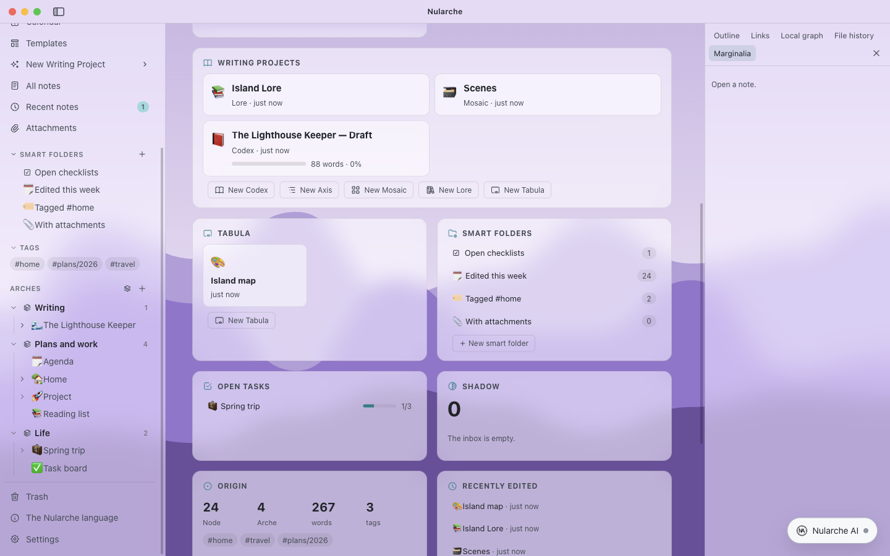
</p>

- **Hide the sidebar:** the sidebar button next to the window buttons (or ⌥⌘B / Ctrl+Alt+B) hides the sidebar
  completely. Hover the button and the sidebar slides in as a panel tinted by your background; move away and it
  hides again. Click the button to bring it back for good. On Windows and Linux the button sits at the top left of the
  window while the sidebar is hidden.
- With a background, the Atrium cards and the cards and lists on other pages are frosted glass too, so nothing looks
  pasted on. The glass blur now renders in the desktop app (it was missing before).
- The `/` menu opens above the line when you type near the bottom of the window, so it never covers your text.

<p align="center">
  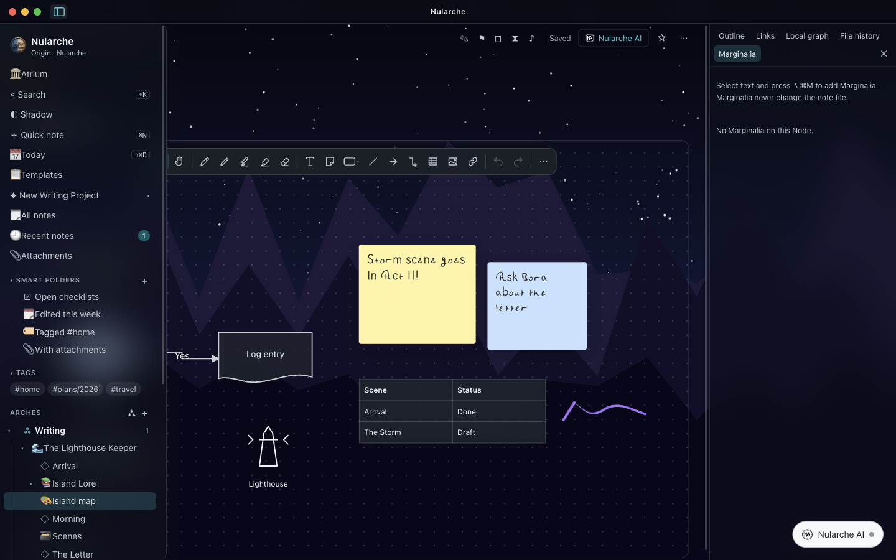
  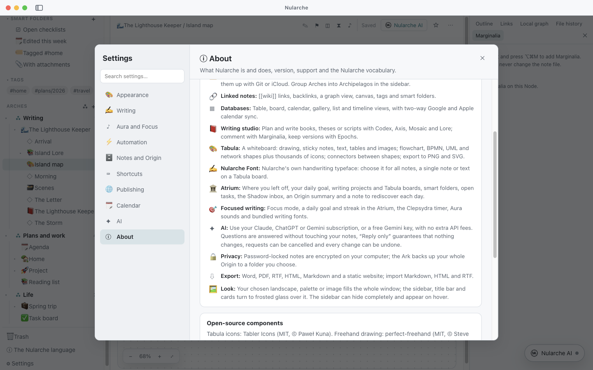
</p>

**Nularche AI**
- A request that gets no answer from Gemini stops after a time limit with a clear message instead of waiting forever
  and blocking the requests behind it. **Cancel** stops a request at any time; a request left “working” after a
  restart can be cleared from the history.
- Long notes are reorganised block by block, so Gemini moves your text unchanged instead of rewriting the whole note.
- Nularche AI only changes notes when you ask for a change. Questions, summaries and analysis are answered without
  editing, and the **Reply only** switch removes every editing tool. Any change can still be undone with **Undo**.
- The full text of your request is shown, and the input box grows as you type.

## What's new in 2.0.0

Nularche 2.0 adds a **writing studio** for long-form work: novels, theses, scripts and reports. Its parts have their own
Nularche names, explained in the [Glossary](#glossary) and on the *Vocabulary* step of the first-run wizard. Everything still lives
in plain Markdown files in your Origin; the new page types keep their structure in a small JSON block inside the note,
the same way canvas pages do, so they open in any editor and track nicely in Git.

<p align="center">
  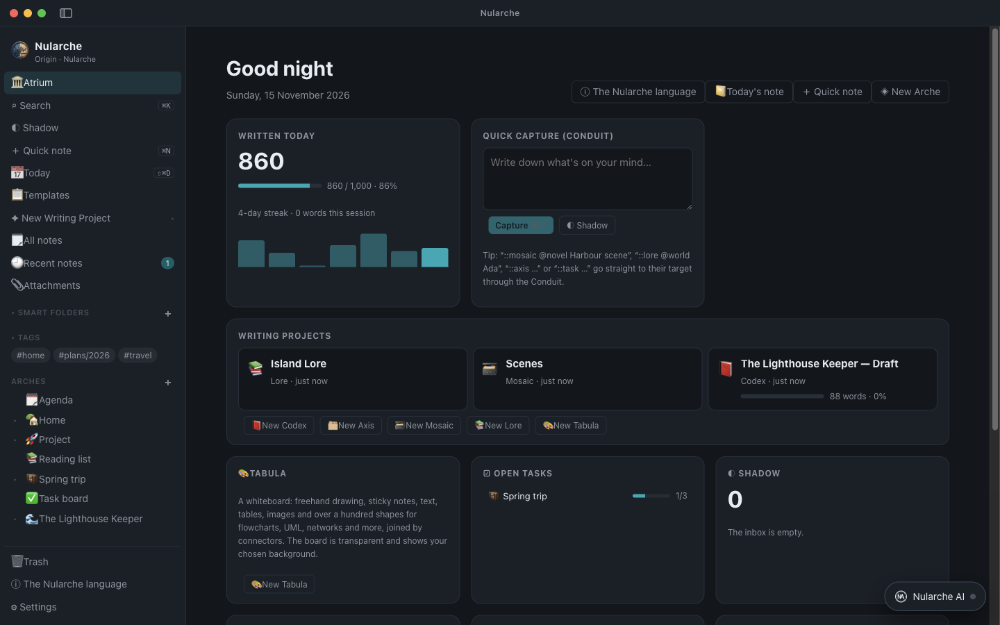
</p>

**Writing projects**

<p align="center">
  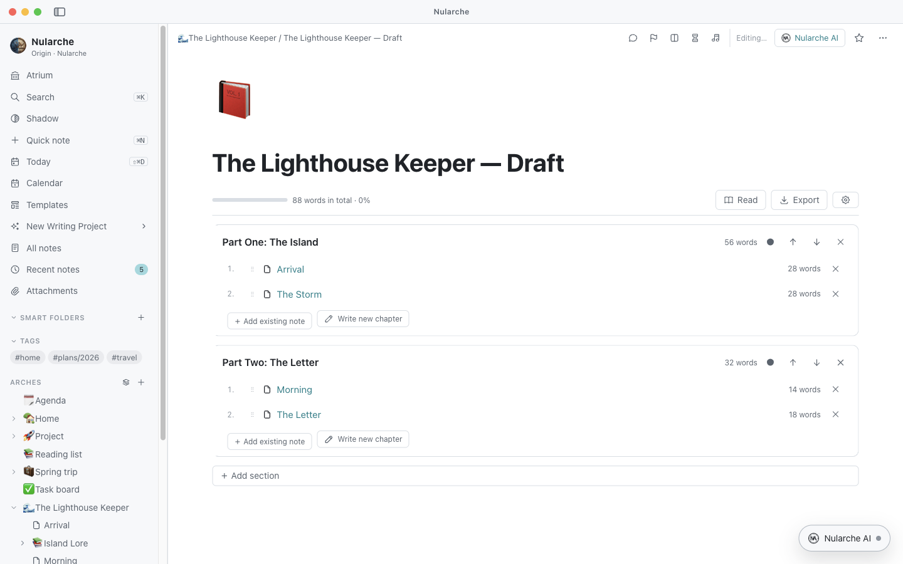
  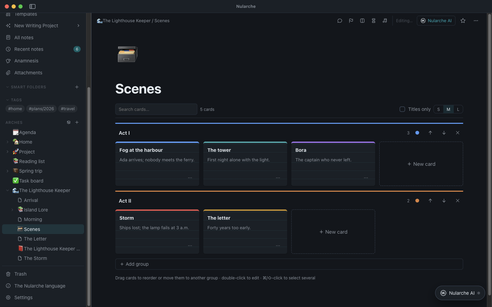
</p>

- **Codex** (manuscript): put notes in order in sections and work on them as one book. You get a running word count against a
  goal, a **Read** view of the whole text, and export of the compiled manuscript to **Word**, **PDF**, **RTF**, plain
  text or HTML. You choose whether section names and note titles appear and which separator goes between notes (`* * *`
  by default). The notes themselves never move. Drag them to reorder, add existing notes, or write a new chapter in
  place.
- **Axis** (outline): hierarchical planning rows (I. → A. → 1. → a.). Use Enter for a new row, Tab / ⇧Tab to indent, ⌥↑ / ⌥↓ to
  move a row and ⌘↩ for row notes. Rows can be folded, colour-labelled, ticked off, linked to a note or turned into one.
  A Codex can **follow an Axis**: rows that haven't been written yet appear as *planned* pages, with the deeper
  rows shown as their beats. **Write it** creates the chapter and links it back to the row.
- **Mosaic** (corkboard): index cards in groups for scenes and ideas. Drag cards between groups, give them colour
  labels, search them, choose S / M / L size or titles only, and select several to colour or delete together. A card
  can be linked to a note or turned into one.
- **Lore** (story bible): sub-pages of a Lore page are entries, and entries with sub-pages are categories. Each entry shows
  its **quick facts** (the note's properties), aliases and excerpt. A category can define the fields that new entries
  get. **Mention detection** puts a dotted underline under an entry's name or aliases wherever they appear in your
  notes. ⌘/Ctrl-click opens the entry and ⌘-hover previews it. Each entry lists **Mentioned in** with counts, and
  detection can be turned off per entry.

<p align="center">
  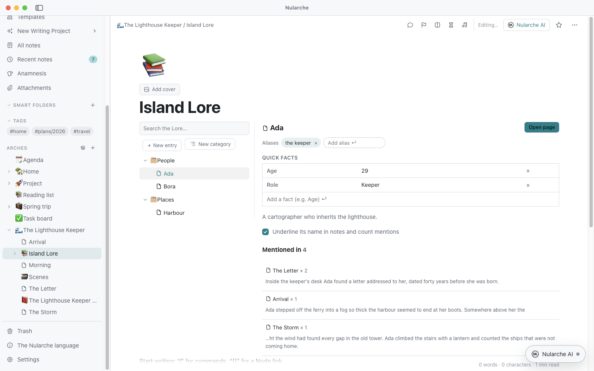
  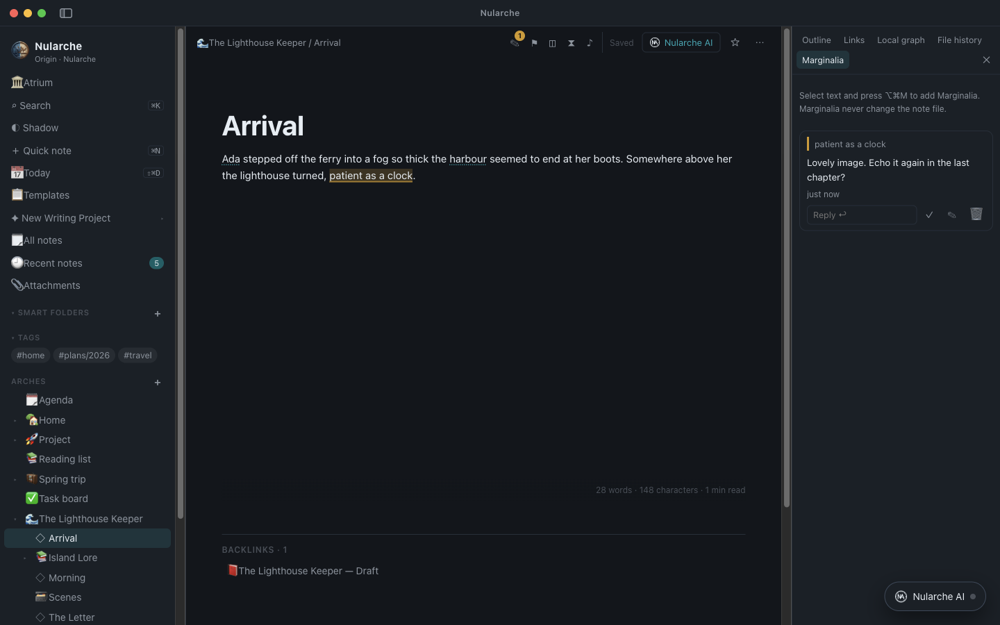
</p>

**Reviewing and revising**
- **Marginalia** (comments) on any passage (⌥⌘M / Ctrl+Alt+M) open a thread in the side panel where you can reply, resolve, reopen,
  edit or delete. Marginalia live in `.nularche/comments/`, so **the Markdown file never changes**. If the commented
  text is later rewritten, the Marginalia is marked as detached instead of being lost.
- **Epochs** (⌥⌘S / Ctrl+Alt+S) are named versions (checkpoints) that are kept until you delete them, up to 30 per note. Any
  snapshot or Epoch can be **compared with the current text** line by line before you restore it.
- **Diptych** (split view, `⌥⌘\` / `Ctrl+Alt+\`) opens a second note beside the current one. You can swap panes, move focus
  between them or close the side pane.

**Writing experience**
- **Atrium**, the home page: a greeting, *continue where you left off*, words written today against a **daily
  goal**, your writing **streak**, a seven-day chart, writing projects with their progress, recently edited and pinned
  notes, and a quick capture box.
- **Word goals** per note or Codex (⋯ → *Word Goal*), with a progress bar under the page.
- **Clepsydra**, the writing timer (⌥⌘P / Ctrl+Alt+P), with focus and break periods, a chime and a draggable widget that also stays in
  focus mode.
- **Aura**, typewriter sounds and ambience: key clacks (light portable or heavy desk machine), the carriage return and a
  **margin bell**, plus rain on the window, a mantel clock, a summer night or a fireplace. Every sound is generated on
  your computer and nothing is downloaded.
- **Six bundled writing fonts** under open licences, all working offline: Atkinson Hyperlegible, Literata, Lora,
  Crimson Pro, Courier Prime and Special Elite. Pick one per page (⌘T) or as the default for all pages.
- **High-contrast theme** for both light and dark.

**Automation**
- **Sigils** (text shortcuts): type an abbreviation (for example `;sig`) followed by a space or punctuation and it expands. The
  expansion can use `{{date}}`, `{{time}}`, `{{title}}` and `{{date:DD.MM.YYYY}}`.
- **Rites** (custom commands) insert text, open a note, capture to Shadow or run a sequence of commands. They appear with ★ in
  the command palette and can get their own hotkeys. Shortcuts and commands can be saved to a file and loaded again.
- **Conduit** (smart capture): captures that start with `::mosaic @novel Harbour scene`, `::axis …`,
  `::lore @world Ada` or `::task …` go straight to the Mosaic, Axis, Lore or note mapped to the `@handle`. Without a mapping they go to
  a page whose title matches the handle, otherwise to the default destination. Anything that doesn't route waits in
  Shadow, where **Send to…** files it later. Rules live in `.nularche/capture.json`.
- **Ark**, automatic backup (desktop): the whole Origin is written as a `.nla` archive to a folder you choose, hourly, daily
  or weekly, and the oldest backups are removed. Pick an iCloud Drive, Google Drive or OneDrive folder to have the
  backups synced; Nularche never signs in to anything.

<p align="center">
  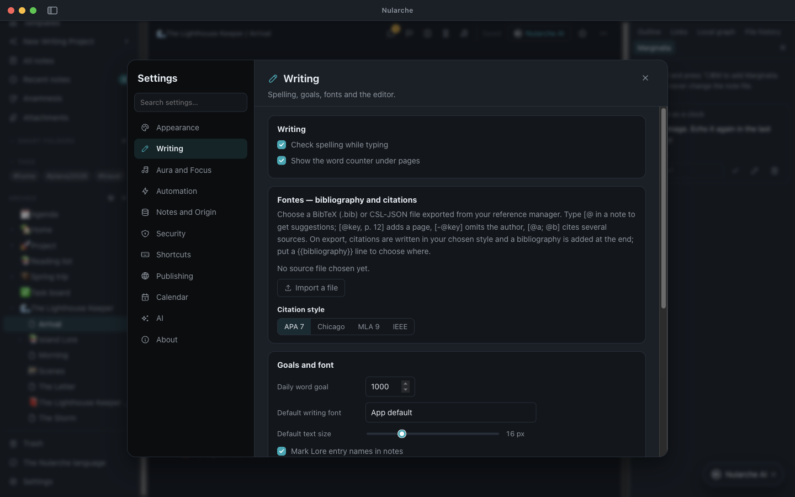
  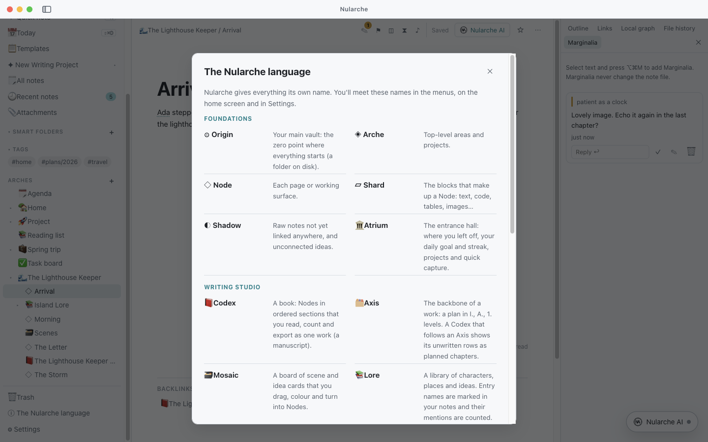
</p>

**Finding everything without the menu bar**
- **Sidebar:** 🏛 **Atrium**, ✦ **New Writing Project** (Codex, Axis, Mosaic or Lore, each with a one-line
  explanation) and ⓘ **The Nularche language**.
- **Note toolbar:** ✎ Marginalia (with a count), ⚑ Epoch, ◫ Diptych, ⧗ Clepsydra and ♪ Aura. Hovering any button
  shows what its name means.
- **Selection bubble:** ✎ **Marginalia** comments on the selected text.
- **`/` menu:** a *Writing studio* group creates a Codex, Axis, Mosaic or Lore under the current page, and runs Epoch,
  Diptych and Clepsydra.
- **Focus mode:** Clepsydra and Aura buttons in the top bar.
- **Settings** are grouped into categories with search (see [Settings](#settings)).
- **Settings → About** explains what Nularche is and does, lists its main features and gives the support address.


**A window that matches your background**
- When a writing background is shown (*Also show the background on normal pages* in the focus-mode background settings, or in focus mode), it
  fills the whole window. The sidebar, the side panel and the title bar become frosted glass over it, so they take
  on the colours of the chosen landscape, palette, colour or your own image. Text stays readable: light on dark
  backgrounds, dark on light ones.
- With no background, the sidebar and title bar follow the app's own theme (Dark, Light or System) rather than the
  operating system's.
- On macOS Nularche draws its own title bar (the window buttons stay where they are, and you drag the window by the
  bar). On Windows and Linux the native title bar and menus switch to dark or light to match the background.

<p align="center">
  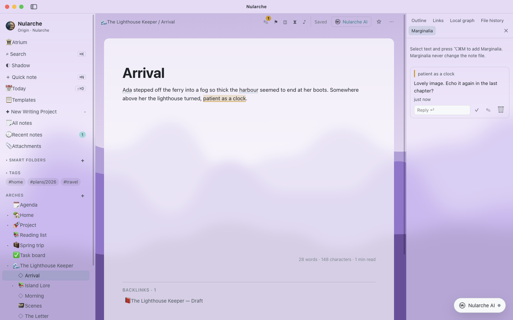
  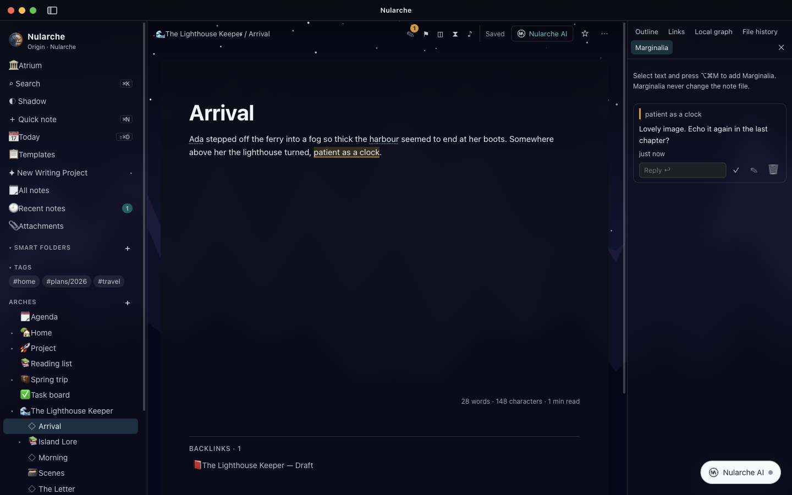
</p>
<p align="center">
  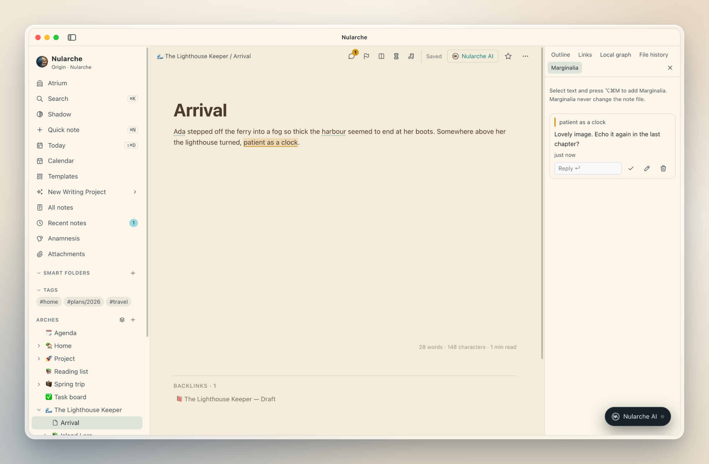
</p>

**AI**
- The MCP server gains `get_manuscript`, `add_to_writing_project`, `list_wiki_entries`, `get_wiki_mentions`,
  `list_comments`, `add_comment` and `create_checkpoint`. `capture_to_shadow` follows the smart-capture rules.

Notes written with 1.x open unchanged. The new page types are ordinary Markdown files that older versions show as a
code block.

## What's new in 1.5.0

<p align="center">
  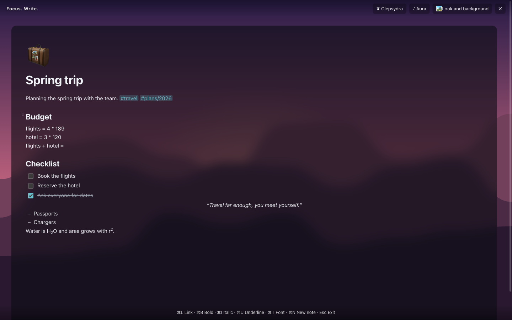
</p>

Nularche 1.5 brings the everyday note-taking features of Apple Notes, the distraction-free writing of a focused writer
app and a linked-notes workflow into Nularche, while your notes stay plain Markdown files. Wiki links, front matter,
callouts and footnotes written in other Markdown apps keep their syntax when you edit them in Nularche.

**Focused writing**
- **Focus mode** (⇧⌘F / Ctrl+Shift+F): full screen, no sidebar or toolbars. The top and bottom bars appear when you
  move the mouse and fade away while you type. Optional typewriter scrolling and "highlight only the current
  paragraph".
- **Writing backgrounds:** ten landscapes drawn for Nularche (Moonlight, Night Sky, Sunset, Snowy Peaks, Dunes,
  Lavender Hills, Calm Sea, Misty Mountains, Autumn, Pine Forest), ten colour palettes, any custom colour or your own
  picture. Use them in focus mode or on every page.
- **Word counter** under every page: words, characters and reading time, or the counts of the selection.
- **Font and size per page** (⌘T / Ctrl+T), plus bigger/smaller text (⌥⌘= / ⌥⌘−).
- **Link dialog** (⌘L / Ctrl+L) with address checking; ⌘/Ctrl-click opens a link, a plain click lets you edit it.

<p align="center">
  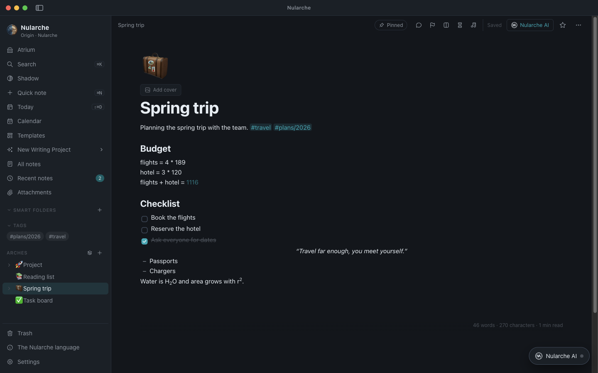
  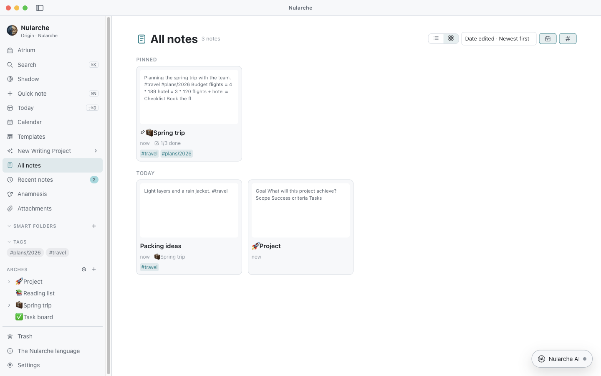
</p>

**Organising and finding**
- **#Tags:** type `#tag` (or `#area/subtag`) anywhere in a note. Tags get their own list in the sidebar, can be
  renamed everywhere at once, and ⌘/Ctrl-click on a tag opens its notes.
- **Smart folders:** saved lists that fill themselves: by tags, date created or edited, checklists (open or done),
  attachments, Arche, pinned or locked. Any Arche can be turned into a smart folder.
- **Note lists:** All notes, Recent notes, a tag, a smart folder or any Arche as a **list** or **gallery** (with a
  preview picture), sorted by date edited, date created or title, grouped by date (Today, Yesterday, Previous 7 days…)
  and with an optional note count. **Pinned** notes stay on top.
- **Attachments browser:** every photo, drawing, recording and file in one place; filter by type, rename (links are
  updated) and jump to the note that uses it.
- **Find and replace** inside a note (⌘F, ⌥⌘F, ⌘G), with Turkish-aware case matching and an option to treat
  ç/c, ş/s… as equal.

**Writing and formatting**
- Paragraph styles (Title, Heading, Subheading, Body, Monostyled), **alignment** (left, centre, right, justify),
  **indent**, **right-to-left** paragraphs, **superscript** and **subscript**, a **dashed list**, upper/lower/title
  case, copy and paste style, and paste and match style (⌥⇧⌘V).
- **Collapsible sections:** fold everything under a heading, or all headings at once.
- **Checklists:** check or uncheck all, move checked items to the bottom (once or always), delete checked items.
- **Math results:** end a line with `=` (`120*3 =`, `rent + fees =`) and Nularche suggests the result (Tab inserts
  it). Lines like `rent = 1500` define variables. A small, safe calculator: no code is ever run.
- **Audio recordings** in a note, with optional **transcription or a summary** through Automatic mode (your own
  Gemini key; the audio goes only to Google, only when you ask).
- **Drawings:** a simple pen, marker and eraser canvas, saved as an editable PNG.
- **Read aloud** with your system voices.

**Security, import and export**
- **Lock a note** with a password. The content is encrypted on your computer (AES-256-GCM, key derived with
  PBKDF2-SHA-256), so the `.md` file holds only ciphertext. Locked notes are hidden from search, export and AI tools;
  *Close all locked notes* locks them again. There is no recovery if you forget the password.
- **Import** Markdown, plain text, HTML and RTF files or whole folders into Shadow (images they reference are copied),
  for example notes exported from Apple Notes. **Copy as Markdown** and **Paste as Markdown**.
- **Export** a page as **Word (.docx)**, **RTF** or **plain text**, in addition to Markdown, HTML and PDF.
- **Print** (⌘P), **open a note in its own window**, **Keep on top**, and **show a note with a light background**
  while the app is dark.
- New **Format** and **View** menus on every platform; all shortcuts are listed with ⌘/ (Ctrl+/).
- The MCP server gains `list_tags` and tag search (`search_nodes` with `tag`), and refuses to read or change locked
  notes.

<p align="center">
  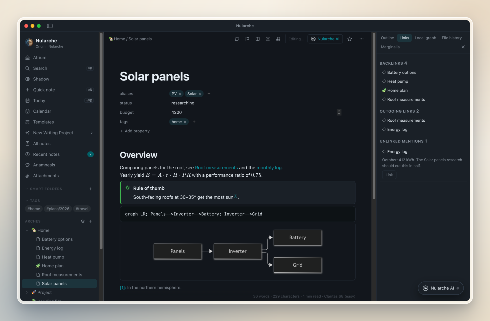
</p>

**Calendar sync (Google and Apple)**
- Sync a database's dated rows both ways with **Google Calendar**, **Apple Calendar (iCloud)** or both: rows with a
  date become events, events become rows, and titles and dates follow changes in either direction. See
  [Calendar sync](#calendar-sync-google-and-apple). Since 2.5 calendars can also be shown on the Calendar page without
  a database.

<p align="center">
  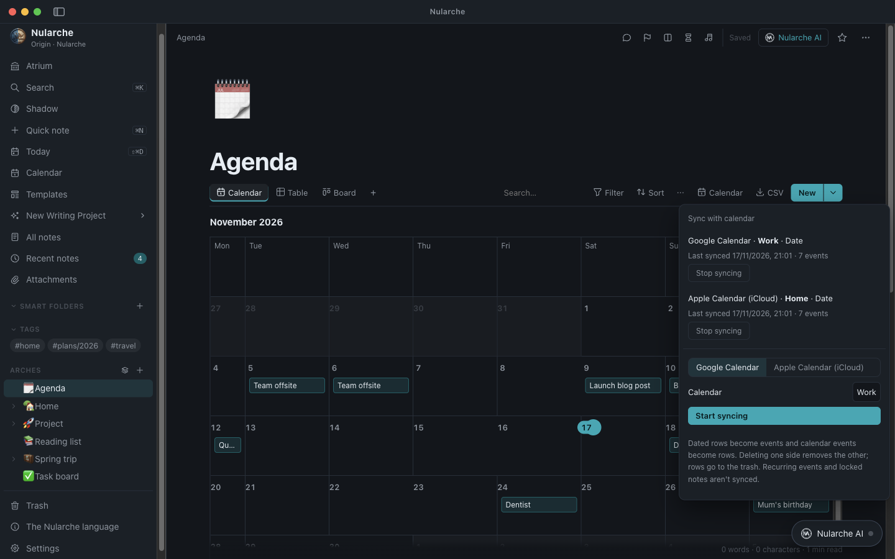
  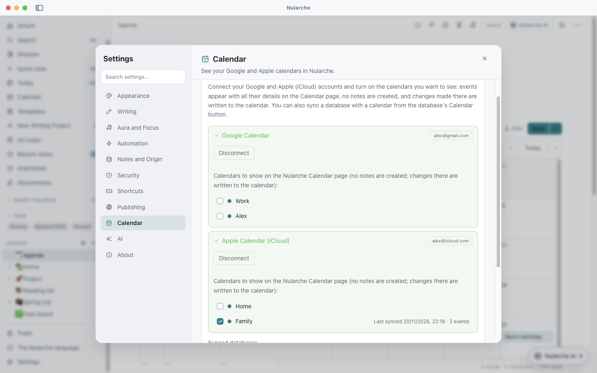
</p>

**Linked notes**
- **Wiki links and embeds:** `[[Note]]`, `[[Note#Heading|shown text]]` and `![[Note]]` (shows the note or one of its
  sections inside the page). Links resolve by title, file name or alias; clicking a link to a note that doesn't exist
  yet creates it. Nularche's own links stay ordinary relative Markdown links.
- **Properties:** typed fields at the top of a note (text, list, number, checkbox, date), stored as YAML front matter
  in the standard place other Markdown apps read them. `aliases` and `tags` are understood. Add one with ⌘; (Ctrl+;).
- **Command palette** (⇧⌘P / Ctrl+Shift+P) runs any command; the **quick switcher** (⌘O / Ctrl+O) opens a note by
  name or alias and creates it if it doesn't exist (⇧↩). **Back and forward** with ⌥⌘← / ⌥⌘→.
- **Graph view** of the whole Origin (filter, orphans, unresolved links, tags) and a **local graph** of the open note.
- **Side panel** (⇧⌘O / Ctrl+Shift+O): **outline**, **backlinks**, **outgoing links**, **unlinked mentions** (turn
  one into a link with a click), local graph and **file history** (a snapshot at most every five minutes while a note
  changes; preview and restore).
- **Canvas:** an infinite board of text, note, web link and group cards joined by arrows, saved in the open
  [JSON Canvas](https://jsoncanvas.org) format inside the note; cards count as links and follow renamed notes.
- **Tabs and workspaces:** open pages in tabs (⌥⌘T new tab, ⌥⌘W close, Ctrl+Tab to switch; ⌘↩ in the quick switcher
  opens in a new tab), and save or load a set of tabs as a named workspace. Nularche reopens the last page, today's
  note or the home page at startup.
- **Page preview:** hold ⌘ (Ctrl) and hover a link to see the note; in reading view, the side panel and backlinks a
  plain hover is enough.

<p align="center">
  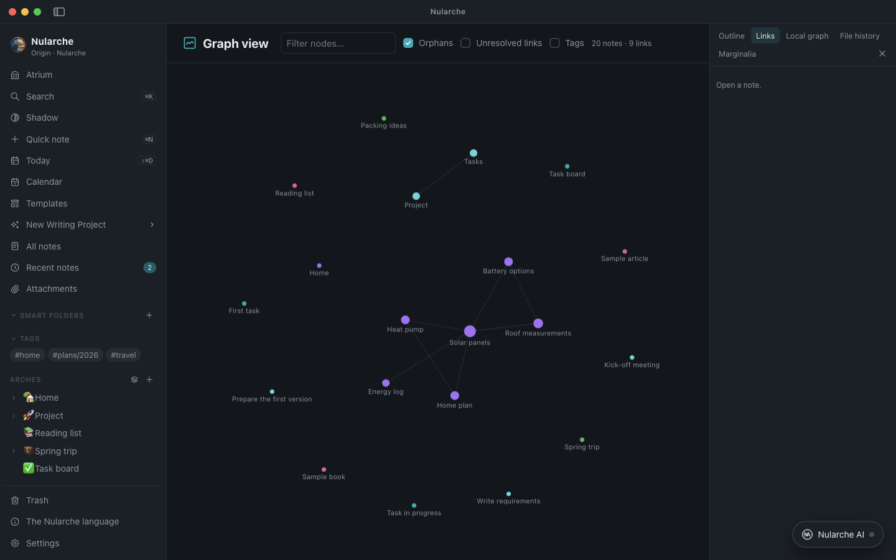
  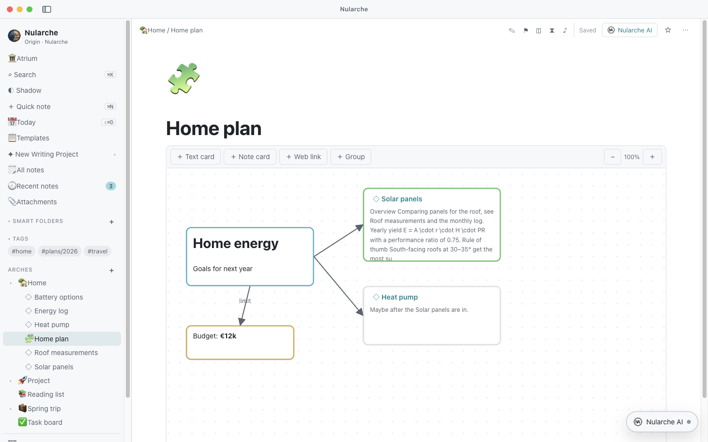
</p>

- **Markdown extras:** LaTeX formulas (`$…$`, `$$…$$`, drawn with KaTeX), **Mermaid** diagrams, footnotes (`[^1]`),
  `%%comments%%` (never published or exported), all common callout types with titles and fold markers, and moving
  a line or list item with ⌥↑ / ⌥↓.
- **Note composer:** merge a note into another (links are redirected), or extract the selection or a heading's section
  into a new note that is linked in its place. **Templates** fill in `{{title}}`, `{{date}}`, `{{time}}` and formats
  such as `{{date:DD.MM.YYYY}}`, and can be inserted into the current note. **Random note**, **unique note** (time-stamped title), previous/next
  daily note, **reading view** (⌥⌘E), **slides** from a note split by `---`, copy the file path and show it in the
  Finder/file manager.
- **Vault settings:** your own **hotkeys** for every command (with conflict warnings), **CSS snippets** from
  `.nularche/snippets/`, an **accent colour**, **readable line length**, default view (editing or reading),
  properties shown or hidden, where new notes go, what opens at startup, **auto-pairing** of brackets and quotes, and
  **excluded files**.
- The MCP server gains `get_links` (outgoing links, unresolved targets and unlinked mentions), reads `[[wiki]]` links
  for backlinks, and `update_node` can set properties.

## Download

> **Easiest on a Mac:** paste this into Terminal. It downloads the right build for your Mac, installs it and opens
> it, with no security prompt:
> ```bash
> curl -fsSL https://raw.githubusercontent.com/VerseOfAC92/nularche/main/scripts/install/install.sh | bash
> ```
> Downloading the DMG in a browser works too; see [First launch](#first-launch) for the one-time step.

| System | Installer |
| --- | --- |
| macOS, Apple Silicon (M1–M5) | [`Nularche-macOS-AppleSilicon.dmg`](https://github.com/VerseOfAC92/nularche/releases/latest/download/Nularche-macOS-AppleSilicon.dmg) |
| macOS, Intel | [`Nularche-macOS-Intel.dmg`](https://github.com/VerseOfAC92/nularche/releases/latest/download/Nularche-macOS-Intel.dmg) |
| Windows 10/11, 64-bit | [`Nularche-Windows-x64-Setup.exe`](https://github.com/VerseOfAC92/nularche/releases/latest/download/Nularche-Windows-x64-Setup.exe) |
| Windows 10/11, 32-bit | [`Nularche-Windows-x86-Setup.exe`](https://github.com/VerseOfAC92/nularche/releases/latest/download/Nularche-Windows-x86-Setup.exe) |
| Linux, Debian/Ubuntu (amd64) | [`Nularche-Linux-amd64.deb`](https://github.com/VerseOfAC92/nularche/releases/latest/download/Nularche-Linux-amd64.deb) |

Not sure which Mac you have? Open  → **About This Mac**. "Apple M…" means Apple Silicon; "Intel" means Intel.
Every installer is built, installed and smoke-tested on its own operating system by the
[release workflow](.github/workflows/release.yml) before it is published.

### First launch

The apps are not yet signed with paid Apple and Microsoft developer certificates, so the first launch needs one
extra step:

- **macOS:** the easiest way is the [terminal installer](#install-from-the-terminal), which opens Nularche without
  any warning. If you downloaded the DMG in a browser, macOS 15 or newer shows **"Nularche.app" Not Opened**. Click
  **Done** (not *Move to Bin*), then right away open **System Settings → Privacy & Security** and scroll to the
  **Security** section. Under *Allow applications from* you will see *"Nularche.app" was blocked…*; click
  **Open Anyway** and confirm with your password. You only do this once. The button only appears for a short while
  after the warning, so if it is missing, open Nularche again, click **Done** and go straight back.
  Alternatively, run this once in Terminal:
  ```bash
  xattr -dr com.apple.quarantine /Applications/Nularche.app
  ```
- **Windows:** if SmartScreen shows *Windows protected your PC*, click **More info** → **Run anyway**. Nularche
  installs for your user only; no administrator rights are needed.
- **Linux:** install with `sudo apt install ./Nularche-Linux-amd64.deb`, then start it from the
  applications menu or run `nularche`. No extra step is needed.

On first launch Nularche asks, in its own window, whether your notes should live on **this computer** (the
`Documents/Nularche` folder, your **Origin**) or sync through **Google Drive**, and offers to connect an AI. Both can be
changed later in **Settings**.

**Updating from 1.x or 2.0:** install 2.5 over the old version the same way (drag it to Applications on macOS, run the
installer on Windows, `sudo apt install ./Nularche-Linux-amd64.deb` on Linux) or run the terminal installer again.
Your Origin folder, notes and settings stay as they are; older notes open unchanged.

## Install from the terminal

### Option 1: download the latest release (recommended)

**macOS** (Terminal), picks the Apple Silicon or Intel build automatically:

```bash
curl -fsSL https://raw.githubusercontent.com/VerseOfAC92/nularche/main/scripts/install/install.sh | bash
```

**Linux, Debian/Ubuntu** (Terminal):

```bash
curl -fsSL https://raw.githubusercontent.com/VerseOfAC92/nularche/main/scripts/install/install.sh | bash
```

**Windows** (PowerShell), picks the 64-bit or 32-bit build automatically:

```powershell
irm https://raw.githubusercontent.com/VerseOfAC92/nularche/main/scripts/install/install.ps1 | iex
```

The scripts install only Nularche. You can read them first:
[`install.sh`](scripts/install/install.sh) · [`install.ps1`](scripts/install/install.ps1).

### Option 2: clone with git and build from source

Requirements: [git](https://git-scm.com) and [Node.js 24 or newer](https://nodejs.org) (with npm). The scripts
check for them but do not install them.

**macOS / Linux** (Terminal):

```bash
git clone https://github.com/VerseOfAC92/nularche.git
cd nularche
./scripts/install/build-from-source.sh
```

**Windows** (PowerShell):

```powershell
git clone https://github.com/VerseOfAC92/nularche.git
cd nularche
.\scripts\install\build-from-source.ps1
```

They run `npm ci` and the test suite, build the installer for your machine into `release/` and install it.

## Features

<p align="center">
  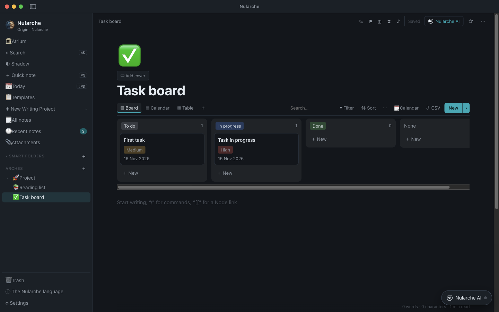
  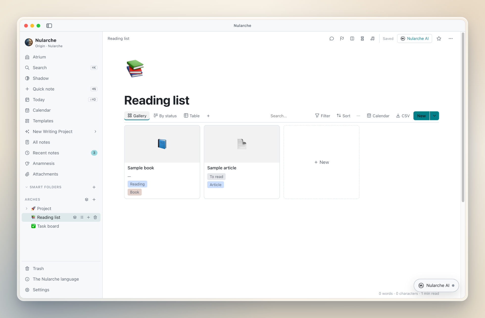
</p>

### Your data, as plain files

- Every page is a Markdown (`.md`) file inside your **Origin** folder. A page with sub-pages lives in its own folder
  (`Project/Project.md`), and images and files go into `Attachments/`.
- Open and edit your notes in any editor (VS Code, TextEdit, other Markdown apps…) and back them up with Time Machine, iCloud,
  OneDrive or Git.
- **Trash:** deleted pages, with their sub-pages, wait in the Trash and can be restored to their original place.

### Structure

- **Arche:** top-level areas or projects, with unlimited nested pages (**Nodes**) beneath them.
- **Shadow:** an inbox for quick thoughts that do not belong anywhere yet, plus a list of unlinked pages.
- **Daily note:** one click (or a shortcut) opens today's journal page.
- **#Tags, smart folders, pinned notes** and note lists (list or gallery, sorted and grouped by date).
- Drag and drop pages in the sidebar, favourites, emoji icons and cover images.

### Databases

<p align="center">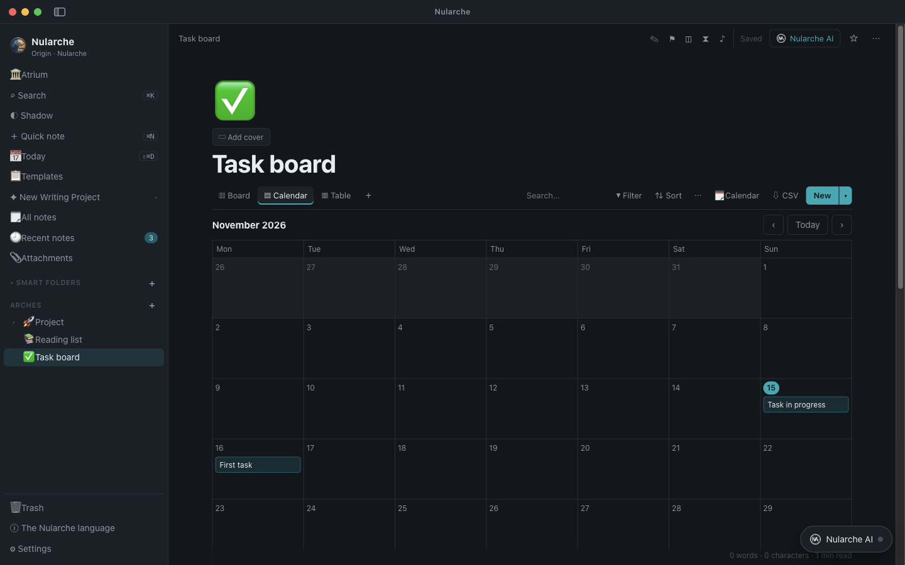</p>

- Six views: **Table, Board (Kanban), List, Gallery, Calendar and Timeline**.
- 15 property types:
  - text, number, date (with ranges) and checkbox;
  - select, multi-select and status;
  - URL, email and phone;
  - relation, rollup and formula;
  - created time and last edited time.
- Filters (all/any), sorting, grouping, search, hidden and resizable columns, and CSV export.
- Drag cards across the board to change their status, or across the calendar to reschedule them.
- Every row is a full page, with its properties on top and free-form notes below.
- Type `/` → **Database** to embed one inside any page.
- Formulas use a small, safe expression language (no code execution), for example
  `if(prop("Done"), "✓", "")` or `dateBetween(prop("Due"), today(), "days")`.

### Calendar sync (Google and Apple)

<p align="center"></p>

There are two ways to use your Google and Apple calendars:

- **Show a calendar** on the Calendar page (Settings → Calendar → tick it under the account). Its events appear with
  all their details, nothing is turned into notes, and what you create, edit or delete on the Calendar page is written
  to the calendar. Nularche reads events from one year ago to two years ahead and refreshes them every 5 minutes.
- **Sync a database** with a calendar: rows with a date become events, events become rows, and titles and dates
  follow changes in either direction. One database can sync with a Google calendar, an Apple (iCloud) calendar or
  both.

<p align="center"></p>

1. **Settings → Calendar** → connect an account:
   - **Google Calendar:** in [Google Cloud](https://console.cloud.google.com/apis/credentials) enable the *Google
     Calendar API* and create an OAuth client of type **Desktop app**. Paste its client ID and secret into Nularche and
     sign in with Google in the browser. Nularche only asks for access to events and the list of your calendars.
   - **Apple Calendar (iCloud):** create an
     [app-specific password](https://support.apple.com/102654) (Apple Account → Sign-In and Security → App-Specific
     Passwords) and enter it with your Apple ID.
2. To show calendars, tick them under the account in **Settings → Calendar**. To sync a database, open it, click
   **Calendar** in its toolbar, choose the calendar (and the date property if there are several) and click
   **Start syncing**.

Nularche then syncs every 5 minutes and when you click **Sync now** in Settings.

<p align="center"></p>

For synced databases:

- A date without a time becomes an all-day event; a time without an end becomes a one-hour event. Date ranges stay
  ranges.
- If both sides changed since the last sync, the latest edit wins.
- Deleting a row deletes its event. An event deleted in the calendar moves its row to the **trash**, where you can
  restore it. Removing a row's date also takes it off the calendar.
- An event's description is copied into the row's note when the row is created; later edits to notes and descriptions
  are not synced.
- Recurring events and password-locked notes are not synced. Events between one year ago and two years ahead are
  imported.
- **Stop syncing** keeps both the rows and the events.
- Account details are encrypted with the system credential store (Keychain, DPAPI or libsecret) and stay on this
  computer; disconnect them in **Settings → Calendar**. The sync map lives with your notes in
  `.nularche/calendar.json`, so moving the Origin to another computer doesn't duplicate events. Events of shown
  calendars are cached in `.nularche/calendar-events.json`.

### Templates

<p align="center">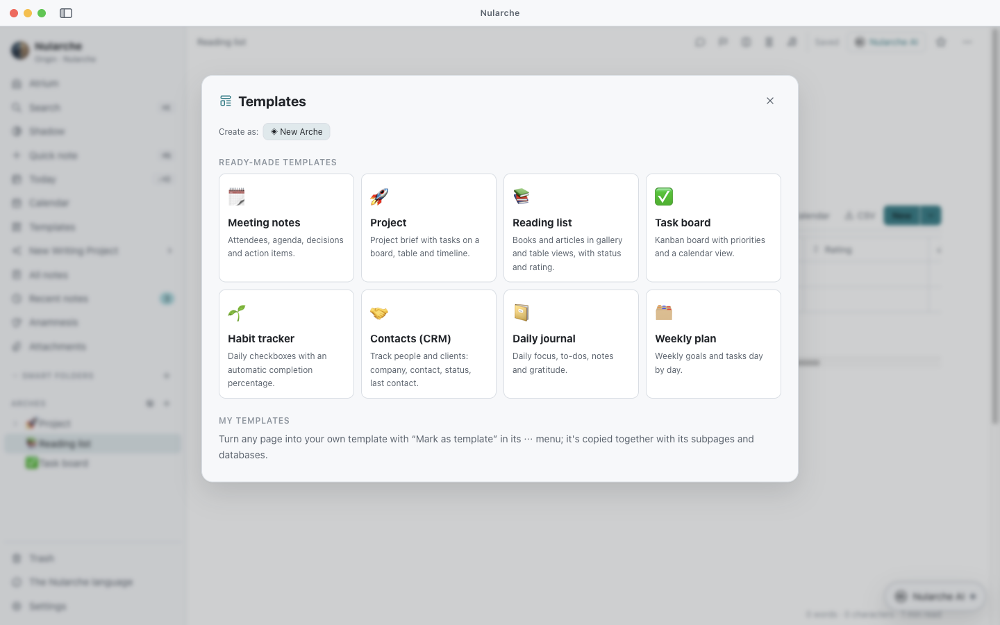</p>

- Eight ready-made templates: Meeting Notes, Project, Reading List, Task Board, Habit Tracker, Contacts (CRM),
  Daily Journal and Weekly Plan.
- Turn any page into your own template. It is copied together with its sub-pages and databases.
- Row templates for databases, and **Duplicate** for any page.

### Writing

- Type `/` for the block menu: headings, lists, to-dos, toggles, quotes, dividers, callouts, tables, code with syntax
  highlighting, images, files and YouTube.
- Bold, italic, underline, strikethrough, highlights, text colours and drag-and-drop block reordering.
- Type `[[` to link another page. Backlinks appear at the bottom, and links and covers update automatically when
  pages are renamed or moved.
- Search everything with a keyboard shortcut. Search is case-insensitive and handles Turkish characters correctly;
  search for `#tag` to find tagged notes.
- Alignment, indent, right-to-left text, superscript/subscript, dashed lists, collapsible sections, find and replace,
  math results, audio recordings and drawings (see [What's new in 1.5.0](#whats-new-in-150)).
- Linked notes: `[[wiki links]]`, embeds, properties, LaTeX, Mermaid, footnotes, `%%comments%%`, callouts,
  graph view, canvas, command palette and quick switcher.

### Tabula (whiteboard)

- A whiteboard page you can create from **New Writing Project**, the Atrium or the `/` menu. It is transparent over
  your writing background, and notes and ink keep a soft halo so they stay readable on any theme.
- Pen, pencil, marker and highlighter (pressure-sensitive with a stylus), eraser, sticky notes, text boxes in every
  note font, tables, images and cards that link to notes.
- Over 130 diagram shapes (flowchart, BPMN, UML, network, callouts…) and about 4,800 icons, plus connectors that stay
  attached when you move shapes. Export a board as PNG or SVG (see [What's new in 2.5.0](#whats-new-in-250)).

### Export and publishing

- Export a page as **Markdown (.zip)**, a **self-contained HTML** file, a **PDF**, **Word (.docx)**, **RTF** or
  **plain text**, or print it.
- **Import** Markdown, text, HTML and RTF files or folders (for example from Apple Notes).
- Mark pages with **Publish to web** and generate a **static website** from them (one HTML page per note, navigation,
  images), ready for GitHub Pages or Netlify. Pages you have not marked are never included, and Nularche never
  uploads anything itself.
- **Archives:** back up the whole Origin as `.nla`, or share one page with its attachments as `.nlc`.

### Settings

Settings open as a window with categories on the left, a search box that filters them, and the chosen category's
settings grouped in cards on the right. The window remembers the last category you opened.

- **Appearance:** theme (System, Light or Dark), high contrast, language (English or Turkish; the interface, menus and
  AI replies switch instantly), accent colour and CSS snippets.
- **Writing:** spell checking, word counter, daily word goal, default writing font, Lore name marking, editor options
  and math results (off, suggest or insert).
- **Aura and Focus:** typewriter sounds and ambience, the Clepsydra timer and the focus-mode background.
- **Automation:** Sigils, Rites and Conduit rules.
- **Notes and Origin:** your notes folder, startup and new-note options, excluded files, Ark backups, archives and
  import.
- **Shortcuts**, **Publishing**, **Calendar**, **AI** and **About** (what Nularche is and does, version, licence,
  the support email and the Nularche vocabulary).

## AI (Claude, ChatGPT, Gemini)

<p align="center">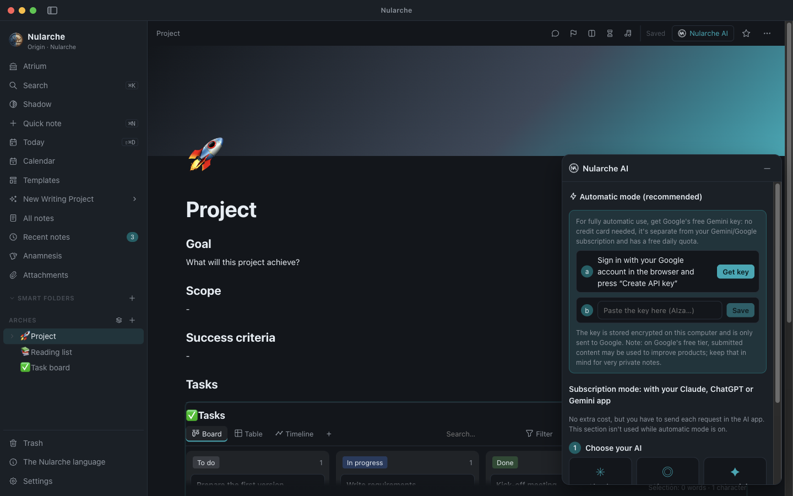</p>

The **Nularche AI** window sits at the bottom right. You can drag it anywhere or minimise it. Open a page and choose
an action: **Fix · Summarise · Expand · To-dos · Link related notes · Translate**. You can also write your own request
or select text to work on just that part. Every AI edit can be undone with one click.

| Mode | How it works | Cost |
| --- | --- | --- |
| **Automatic** | Requests run in the background with a free Gemini API key from Google AI Studio. If a model is busy, Nularche falls back to another. The key is stored encrypted on your computer. | Free tier |
| **Subscription** | Use your own **Claude** (Claude Desktop / Claude Code), **ChatGPT** (desktop app / Codex) or **Gemini** (Antigravity) account. Nularche registers its MCP server with that app in one click and detects when it connects. | Your existing plan; no API fees |

Nularche never sees or stores your AI account credentials. In subscription mode the AI app talks to your notes
through the local `nularche` MCP server, which offers 28 tools: read/search/create/update pages (with properties), Shadow, tags (`list_tags`), links
(`get_backlinks`, `get_links`), databases
(`create_database`, `query_database`, `add_database_row`, `set_row_properties`, `update_database_schema`),
`duplicate_node`, writing projects (`get_manuscript`, `add_to_writing_project`, `list_wiki_entries`, `get_wiki_mentions`),
comments (`list_comments`, `add_comment`), `create_checkpoint`, and the Nularche AI request tools.

## Keyboard shortcuts

Press **⌘ /** (macOS) or **Ctrl + /** (Windows, Linux) in the app to see this list.

| Action | macOS | Windows / Linux |
| --- | --- | --- |
| Search | ⌘ K | Ctrl + K |
| Quick note (Shadow) | ⌘ N | Ctrl + N |
| Today's daily note | ⇧ ⌘ D | Ctrl + Shift + D |
| Save now | ⌘ S | Ctrl + S |
| Settings | ⌘ , | Ctrl + , |
| Keyboard shortcuts | ⌘ / | Ctrl + / |
| Capture to Shadow (in the capture box) | ⌘ ↩ | Ctrl + Enter |
| Command menu / page link | `/` · `[[` | `/` · `[[` |
| Bold · Italic · Underline | ⌘ B · ⌘ I · ⌘ U | Ctrl + B · Ctrl + I · Ctrl + U |
| Strikethrough · Inline code · Highlight | ⇧ ⌘ S · ⌘ E · ⇧ ⌘ H | Ctrl + Shift + S · Ctrl + E · Ctrl + Shift + H |
| Undo · Redo | ⌘ Z · ⇧ ⌘ Z | Ctrl + Z · Ctrl + Y |
| Heading 1 / 2 / 3 | ⌥ ⌘ 1 / 2 / 3 | Ctrl + Alt + 1 / 2 / 3 |
| Bulleted · Numbered · To-do list | ⇧ ⌘ 8 · ⇧ ⌘ 7 · ⇧ ⌘ 9 | Ctrl + Shift + 8 · 7 · 9 |
| Quote · Code block | ⇧ ⌘ B · ⌥ ⌘ C | Ctrl + Shift + B · Ctrl + Alt + C |
| Body text · Dashed list | ⌥ ⌘ 0 · ⇧ ⌘ 6 | Ctrl + Alt + 0 · Ctrl + Shift + 6 |
| Superscript · Subscript | ⇧ ⌘ . · ⇧ ⌘ , | Ctrl + Shift + . · Ctrl + Shift + , |
| Align left · centre · right · justify | ⇧ ⌘ L · E · R · J | Ctrl + Shift + L · E · R · J |
| Indent · Outdent | ⌘ ] · ⌘ [ | Ctrl + ] · Ctrl + [ |
| Link · Font and size | ⌘ L · ⌘ T | Ctrl + L · Ctrl + T |
| Bigger · Smaller text | ⌥ ⌘ = · ⌥ ⌘ − | Ctrl + Alt + = · Ctrl + Alt + − |
| Find · Find and replace | ⌘ F · ⌥ ⌘ F | Ctrl + F · Ctrl + Alt + F |
| Next · Previous match | ⌘ G · ⇧ ⌘ G | Ctrl + G · Ctrl + Shift + G |
| Paste and match style | ⌥ ⇧ ⌘ V | Ctrl + Alt + Shift + V |
| Focus mode · Print | ⇧ ⌘ F · ⌘ P | Ctrl + Shift + F · Ctrl + P |
| Insert a math result | Tab | Tab |
| Command palette · Quick switcher | ⇧ ⌘ P · ⌘ O | Ctrl + Shift + P · Ctrl + O |
| Back · Forward | ⌥ ⌘ ← · ⌥ ⌘ → | Ctrl + Alt + ← · Ctrl + Alt + → |
| Side panel (outline, links, history) | ⇧ ⌘ O | Ctrl + Shift + O |
| Add property · Reading view | ⌘ ; · ⌥ ⌘ E | Ctrl + ; · Ctrl + Alt + E |
| Move line up · down | ⌥ ↑ · ⌥ ↓ | Alt + ↑ · Alt + ↓ |
| Clear formatting | ⌘ \ | Ctrl + \ |
| New tab · Close tab · Next tab | ⌥ ⌘ T · ⌥ ⌘ W · ⌃ Tab | Ctrl + Alt + T · Ctrl + Alt + W · Ctrl + Tab |
| Page preview | ⌘ + hover a link | Ctrl + hover a link |
| Add comment · Create checkpoint | ⌥ ⌘ M · ⌥ ⌘ S | Ctrl + Alt + M · Ctrl + Alt + S |
| Open a note beside (split view) | ⌥ ⌘ \ | Ctrl + Alt + \ |
| Writing timer | ⌥ ⌘ P | Ctrl + Alt + P |
| Hide / show the sidebar | ⌥ ⌘ B | Ctrl + Alt + B |
| Outline: new row · indent · outdent · row notes | ↩ · Tab · ⇧ Tab · ⌘ ↩ | Enter · Tab · Shift + Tab · Ctrl + Enter |

Every command's shortcut can be changed in **Settings → Keyboard shortcuts**.

## Where things are stored

| | macOS | Windows | Linux |
| --- | --- | --- | --- |
| Notes (default Origin) | `~/Documents/Nularche` | `Documents\Nularche` | `~/Documents/Nularche` |
| Settings | `~/Library/Preferences/io.nularche.app` | `%APPDATA%\Nularche\config` | `~/.config/nularche` |
| App data | `~/Library/Application Support/Nularche` | `%LOCALAPPDATA%\Nularche\data` | `~/.local/share/nularche` |

Inside the Origin, the hidden `.nularche/` folder holds the app's own data, which travels and is backed up with your
notes: `ui.json` (preferences, word log), `history/` (snapshots and named checkpoints), `comments/` (comment threads),
`capture.json` (smart-capture rules), `snippets/` (CSS snippets), `annotations/` (Lectio highlights) and
`anamnesis.json` (flashcard review state). `snapshots/` holds the encrypted Strata snapshots; like automatic version
history, they stay on this computer and are never synced to Google Drive. Automatic backups go to the folder you choose.

**Uninstall:** delete `Nularche.app` (macOS), use **Settings → Apps** (Windows) or run `sudo apt remove nularche`
(Linux). Uninstalling never deletes your notes.

Uninstalling also keeps your settings, including a saved Gemini API key, so a reinstall picks up where you left off.
Nothing personal is ever stored inside the app itself: every new installation starts with an empty AI setup. To remove
a saved key, use **Settings → AI → Automatic mode → Remove key**. Calendar accounts are removed with **Settings → Calendar →
Disconnect**. To reset Nularche completely, quit it and delete the
**Settings** and **App data** folders listed above, for example on macOS:

```bash
rm -rf ~/Library/Preferences/io.nularche.app ~/Library/Application\ Support/Nularche
```

## Glossary

| Term | Meaning |
| --- | --- |
| **Origin** | Your notes folder. |
| **Arche** | A top-level area or project. |
| **Node** | A page. |
| **Shard** | A block inside a page (text, table, image…). |
| **Shadow** | The inbox for quick, not-yet-filed notes. |
| **Archipelago** | A group of Arches in the sidebar; it arranges the view without moving any files. |
| **Atrium** | The home page: where you left off, daily goal and streak, projects, smart folders, quick capture. |
| **Codex** | A manuscript: Nodes in ordered sections, read, counted and exported as one work. |
| **Axis** | An outline: the backbone of a work in I., A., 1. levels; a Codex can follow it. |
| **Mosaic** | A corkboard of scene and idea cards. |
| **Lore** | A story bible of characters, places and ideas; entry names are marked in your notes. |
| **Tabula** | A whiteboard page that sits over your writing background: ink, sticky notes, shapes, icons and connectors. |
| **Marginalia** | Comments left beside a passage without changing the text. |
| **Epoch** | A named version (checkpoint) you can compare with and restore. |
| **Diptych** | Two Nodes side by side (split view). |
| **Clepsydra** | The writing timer with focus and break periods. |
| **Aura** | Typewriter sounds and ambience. |
| **Sigil** | A text shortcut that expands as you type. |
| **Rite** | A custom command. |
| **Conduit** | Smart capture that routes `::mosaic`, `::axis`, `::lore` and `::task` notes to their target. |
| **Ark** | Automatic backups of the Origin to a folder you choose. |
| **Crypta** | An Arche whose notes are all encrypted with one password. |
| **Custos** | Auto-lock: open locked notes close when idle, on sleep and on screen lock. |
| **Strata** | Encrypted, incremental snapshots of the whole Origin that you can restore. |
| **Vigil** | A scheduled automation: a Nularche AI task or a digest note, daily, weekly or monthly. |
| **Fontes** | Your bibliography (BibTeX or CSL-JSON), `[@key]` citations and the bibliography on export. |
| **Lectio** | The PDF reader: highlights, comments and quotes exported to a note. |
| **Tessera** | A block link or embed: `[[Note#^id]]` and `![[Note#^id]]`. |
| **Speculum** | A live query block that lists notes by tag, Arche or property. |
| **Anamnesis** | Flashcards from `Question :: Answer` lines, reviewed with FSRS spaced repetition. |
| **Claritas** | The readability score next to the word count. |

## Development

Nularche is TypeScript end to end. Node.js 24 runs the source directly (type stripping), so tests need no build step.

```text
packages/
  core/      Note store (Markdown files, links, layout, trash), databases, formulas, export, archives, AI activity
  server/    Local HTTP API on 127.0.0.1 (Host/Origin checked) used by the UI
  mcp/       The `nularche` MCP server for Claude / ChatGPT / Gemini apps
  web/       React 19 + TipTap 3 interface (Vite)
  desktop/   Electron main process, menus, dialogs, AI connections, installers
scripts/     build, packaging (dist-mac / dist-win), tests (e2e, MCP, packaged smoke), install scripts
```

```bash
git clone https://github.com/VerseOfAC92/nularche.git && cd nularche
nvm use            # Node.js version from .nvmrc
npm ci
npm test           # core (node:test) + UI (vitest)
npm run typecheck
npm run mcp:smoke  # MCP server end to end
npm start          # browser version at http://localhost:5178 (set NULARCHE_ORIGIN to choose a folder)
npm run desktop    # run the desktop app from source
npm run e2e        # desktop end-to-end test with a temporary home folder
```

Building installers:

| Command | Output (`release/`) |
| --- | --- |
| `npm run dist:mac` | `Nularche-macOS-AppleSilicon.dmg`, `Nularche-macOS-Intel.dmg` |
| `npm run dist:win` | `Nularche-Windows-x64-Setup.exe`, `Nularche-Windows-x86-Setup.exe` |
| `npm run dist:linux` | `Nularche-Linux-amd64.deb` |
| `npm run smoke:packaged -- <app executable>` | Opens an installed build with a temporary profile and checks the UI, storage, API and MCP server |

The 32-bit Windows installer is built with Electron 43, the newest release line that still ships 32-bit Windows
binaries; all other builds use Electron 44.

**Releasing:** bump `version` in `package.json`, add a `## <version>` section to `CHANGELOG.md`, then push a tag
(`git tag v1.0.1 && git push --tags`). The release workflow builds, installs and tests every installer, and publishes
them only if all the tests pass.

Contributions are welcome: open an issue or a pull request. Please keep notes as plain Markdown, keep the app
local-first, and add tests for behaviour changes.

## Third-party artwork

Tabula's icons come from [Tabler Icons](https://tabler.io/icons) (MIT licence, © Paweł Kuna); freehand strokes are
drawn with [perfect-freehand](https://github.com/steveruizok/perfect-freehand) (MIT licence, © Steve Ruiz).

## Support

Questions, ideas or bug reports: write to **[verseofac@gmail.com](mailto:verseofac@gmail.com)** or open an
[issue on GitHub](https://github.com/VerseOfAC92/nularche/issues). The address is also in **Settings → About**.

## Licence

[MIT](LICENSE) © 2026 VerseOfAC92

---

## Türkçe

**Nularche**, notlarınızı kendi bilgisayarınızda düz Markdown dosyaları olarak tutan, yapay zekâ destekli bir not ve
bilgi yönetimi uygulamasıdır. Veritabanları (tablo, pano, takvim, galeri, liste, zaman çizelgesi), şablonlar, günlük
not, Çöp, statik site yayınlama ve Claude / ChatGPT / Gemini entegrasyonu içerir. Arayüz Ayarlar'dan Türkçeye
alınabilir.

### 3.0.0'daki yenilikler

3.0'ın konusu **güven** ve **bildiğinizi kullanmak**. Yeni her parçanın Nularche dilinde bir adı var; anlamları
Nularche dili penceresinde.

**Güvenlik**

- **Crypta (şifreli Arche):** Ayarlar → Güvenlik'ten bir Arche'nin bütün notları tek parolayla şifrelenir (AES-256-GCM,
  PBKDF2 600.000 tur). Parola oturum başına bir kez girilir; Arche'ye eklenen yeni notlar kendiliğinden şifrelenir.
  Başlıklar, özellikler ve ağaç görünür kalır. Parola hiçbir yerde saklanmaz, unutulursa içerik kurtarılamaz.
- **Custos (otomatik kilit):** açık kilitli notlar ve Crypta Arche'leri bir süre işlem yapılmayınca (1–60 dakika,
  varsayılan 5), bilgisayar uyuyunca ya da ekran kilitlenince hemen kapanır.
- **Strata (anlık görüntüler):** Origin'in tamamı, bir şey değiştiyse 15 dakikada bir ve **Şimdi al** ile kaydedilir.
  İçerik adreslidir ve yalnızca değişen dosyalar yeniden saklanır; sistemin anahtar zincirindeki bir anahtarla şifrelidir.
  Değişenleri görün, notu önizleyin, tek dosyayı ya da Origin'in tamamını geri getirin; geri yüklemeden önce şimdiki
  hâlin anlık görüntüsü alınır. Bu bilgisayarda kalır, Google Drive'a gitmez. Kilitlenen notun şifresiz sürümleri bütün
  anlık görüntülerden silinir.
- **Mühürlü yerel bağlantı:** yerel sunucu yalnızca Nularche'nin kendi pencerelerinden gelen istekleri kabul eder;
  arayüz sıkı bir içerik güvenlik politikasıyla çalışır; notlardaki HTML hem uygulamada hem dışa aktarılan ve
  yayınlanan sayfalarda izin listesiyle temizlenir.

**Araştırma ve yazma**

- **Fontes (kaynakça ve atıflar):** Ayarlar → Yazma'dan BibTeX (`.bib`) ya da CSL-JSON dosyası seçin. Notta `[@`
  yazınca kaynaklar önerilir; `[@anahtar, s. 12]` sayfa, `[-@anahtar]` yazarsız atıf, `[@a; @b]` birden çok kaynak.
  Atıflar seçtiğiniz stille biçimli çip olarak görünür; dışa aktarmada (HTML, Word, RTF, yayınlanan site ve Codex)
  yazıya dökülür ve sona (ya da `{{kaynakça}}` satırının yerine) kaynakça eklenir. Stiller: APA 7, Chicago, MLA 9, IEEE.
- **Lectio (PDF okuyucu):** Ekler'den ya da nottaki bağlantıdan PDF açın; metni seçip beş renkten biriyle vurgulayın,
  yorum yazın, **Nota aktar** ile her vurgu o sayfaya dönen bağlantılı bir alıntı olur. Yeni vurgular aynı nota eklenir.
- **Tessera (blok bağlantısı ve gömme):** paragrafa sağ tıklayıp **blok bağlantısını kopyala**: paragrafa kısa bir
  `^kimlik` eklenir ve `[[Not#^kimlik]]` kopyalanır. Bağlantı notu o paragrafta açar; `![[Not#^kimlik]]` paragrafı
  başka bir notta gösterir. Dışa aktarma ve yayınlamada gömülen metin açık yazılır.
- **Claritas (okunabilirlik):** kelime sayısının yanında 0–100 puan (yüksek = kolay); Türkçede Ateşman, İngilizcede
  Flesch formülü.

**Bildiğinizi kullanmak**

- **Speculum (canlı sorgu):** `/` ile eklenen sorgu bloğu `tag: #taslak`, `arche: Tez`, `where: durum = Açık`,
  `where: updated >= -7d`, `sort: updated desc`, `show: table` gibi satırlarla notları liste, tablo, sayı ya da açık
  görev olarak gösterir ve notlar değiştikçe güncellenir.
- **Anamnesis (bilgi kartları):** notlardaki her `Soru :: Cevap` satırı bir kart, `Terim ::: Tanım` iki yönlü iki kart
  olur. Kenar çubuğundaki **Anamnesis** kartları tek tek, FSRS algoritmasıyla unutmak üzereyken sorar (Boşluk cevabı
  gösterir, 1–4 değerlendirir). Arche'ye göre deste ve günlük yeni kart sayısı seçilir.
- **Vigil (zamanlanmış otomasyon):** Ayarlar → Otomasyon'dan her gün, hafta ya da ay belli bir saatte Nularche AI'a iş
  verin ya da Nularche'nin özet notu yazmasını sağlayın. Sonuçlar Atrium'daki Vigil kartında, planlı çalışmalar
  Takvim'de görünür; uygulama kapalıyken kaçırılan çalışma açılışta bir kez yapılır.

### 2.5.0'daki yenilikler

- **Takvim ekranı** (kenar çubuğu ya da ⇧⌘K): ay, hafta ve ajanda görünümleri. Yerel **Nularche** takvimi, Ayarlar →
  Takvim'de açtığınız Google ve Apple (iCloud) takvimleri ve tarih özelliği olan bütün veritabanları bir arada; her
  takvim bir düğmeyle gizlenip gösterilir. Takvimler **not ya da Arche oluşturmaz**: etkinlikler
  `.nularche/calendar-events.json` içinde tutulur, Takvim ekranında yaptığınız değişiklikler doğrudan Google'a ya da
  iCloud'a yazılır. Bir etkinliğe tıklayınca saat, hatırlatma, konum, toplantı bağlantısı (**Aç** düğmesiyle),
  düzenleyen, katılımcılar ve yanıtları ve notlar görünür. Yeni etkinlik konum, bağlantı, hatırlatma ve notlarıyla
  oluşturulur. Yinelenen etkinlikler yalnızca görüntülenir. Veritabanını takvimle eşitleme veritabanının **Takvim**
  düğmesinde durur.
- **Depolama ve Google Drive:** ilk açılışta, sistem uyarısı yerine Nularche'nin kendi penceresinde notların **bu
  bilgisayarda** mı duracağı yoksa **Google Drive** ile mi eşitleneceği seçilir; Ayarlar → Notlar ve Origin'den her
  zaman değiştirilebilir. Google Drive tek tıkla bağlanır (**Google ile bağlan**); Nularche Drive'da yalnızca kendi
  oluşturduğu Nularche klasörünü görür. Bilgisayardaki klasör çalışma kopyası olarak kalır (hızlı, internetsiz çalışır)
  ve Drive ile iki yönlü eşitlenir. Yalnızca notlar, ekler, ayarlar, Marginalia, Epoch'lar ve CSS parçacıkları
  eşitlenir; otomatik sürüm geçmişi, Nularche AI kayıtları ve takvim önbelleği bilgisayarda kalır. Kilitlenen notun
  şifresiz eski sürümleri silinir, Drive'daki eski dosyası da sürüm geçmişiyle kalıcı silinip şifreli hâli yüklenir.
  İsteğe bağlı **uçtan uca şifreleme** Drive'daki kopyayı ve dosya adlarını parolanızla şifreler. Klasör birden
  boşalırsa Drive'dan hiçbir şey silinmez; **Drive'dan geri getir** ve **Drive'dan yeniden indir** her şeyi geri
  getirir. Google Takvim de artık tek tıkla bağlanır.
- **Biçimli başlıklar:** başlığın bir kısmını seçip kalın, italik, altı çizili, üstü çizili, vurgulu ya da renkli
  yapın (seçim çubuğundan ya da sağ tıkla). Dosya adı düz başlık olarak kalır.
- **Sağ tık** menüsünde Nularche'nin seçenekleri (biçim, bağlantı, Marginalia; Tabula'da şekil seçenekleri; kenar
  çubuğunda aç, ekle, taşı) ile sistemin seçenekleri (yazım önerileri, Sözlükte Ara, kes, kopyala, yapıştır, Paylaş)
  birlikte gelir.
- Notlarda **Tab** girinti yapar (liste öğelerini iç içe alır), ⇧Tab geri alır; tablolarda Tab yine hücreler arasında
  gezer. Ayarlar → Yazma'da **varsayılan yazı boyutu** seçilir. Sürükleyerek ayarlanan **tablo sütun genişlikleri**
  notla birlikte kaydedilir. Yazma yönergesi yalnızca boş notta görünür.
- **Görünüm:** menüler, araç çubukları, paneller ve pencereler emoji ve semboller yerine tek bir çizgi simge setiyle
  çizilir (notlarınıza verdiğiniz simgeler olduğu gibi kalır). Arka plan seçiliyken menüler ve pencereler okunaklı
  buzlu cam kullanır; boşluklar, hizalar ve odak durumları uygulamanın her yerinde, Tabula'nın şekil kitaplığı ve
  biçim paneli dahil, elden geçirildi.
- **Tabula** (beyaz tahta): kalem, kurşun kalem, keçeli ve fosforlu kalem, silgi; yapışkan notlar, metin, tablo,
  görsel ve not kartları; akış şeması, BPMN, UML, ağ ve daha fazlası için 130'dan fazla şekil ve 13 grupta yaklaşık
  4.800 simge; şekilleri bağlayan ve şekiller taşınınca onları izleyen oklar; hizalama kılavuzları, gruplama, kilit,
  katman sırası, hizala/dağıt, çevir, geri al/yinele; not yazarken kullanılan bütün yazı tipleri. Tahta saydamdır ve
  seçtiğiniz arka planı gösterir; PNG ve SVG olarak dışa aktarılır. *Yeni yazma projesi* menüsünde, Atrium'da ve “/”
  menüsünde.
- **Nularche Font:** Nularche'nin kendine özel el yazısı yazı tipi eklendi. Ayarlar'da bütün notların yazı tipi,
  tek bir notun yazı tipi ya da Tabula'daki metin, yapışkan not ve şekil yazıları için seçilebilir; uygulamayla gelir,
  çevrimdışı çalışır.
- **Kenar çubuğu tamamen gizlenir** (pencere düğmelerinin yanındaki düğme ya da ⌥⌘B); düğmenin üzerine gelince arka
  planın renginde bir panel olarak belirir, fare çekilince kaybolur.
- **Archipelago:** Arche'ler kenar çubuğunda gruplanabilir (İş, Okul gibi). “Arche'ler” başlığının yanındaki grup
  düğmesiyle (üst üste katmanlar) grup oluşturun; Arche'yi kendi grup düğmesiyle ya da sürükleyerek ekleyin. Gruplar daraltılır, yeniden adlandırılır,
  kaldırılır (Arche'ler silinmez); dosyalar taşınmaz.
- **Atrium** zenginleşti: akıllı klasörler (not sayılarıyla), Tabula panoları, açık görevler, Shadow gelen kutusu, Origin özeti ve her gün yeniden
  keşfedilecek bir not. Arka plan seçiliyken Atrium'daki ve diğer sayfalardaki kartlar da buzlu cam olur.
- **Nularche AI**: yanıt vermeyen istekler süre sınırında açık bir mesajla durur, istekler iptal edilebilir, uzun notlar
  baştan yazılmadan blok blok düzenlenir. Soru, özet ve analiz isteklerinde notlar değiştirilmez; **Yalnızca cevap**
  açıkken hiçbir not değişmez.

### 2.0.0'daki yenilikler

Nularche 2.0, roman, tez, senaryo ve rapor gibi uzun metinler için bir **yazma stüdyosu** ekliyor. Her şey yine Origin
klasörünüzde düz Markdown dosyası olarak kalır. Yeni sayfa türleri yapılarını, tuval sayfaları gibi notun içindeki küçük
bir JSON bloğunda tutar. Yeni bölümlerin Nularche adları ve anlamları ilk açılış sihirbazının **Nularche dili**
adımında ve uygulamadaki **Nularche dili** penceresinde (⇧⌘P → “Nularche dili”) anlatılır.

- **Codex** (manuskript): notları bölümler halinde sıralayıp tek bir eser gibi çalışın. Kelime hedefine karşı toplam sayaç,
  bütün metni gösteren **Oku** görünümü ve derlenmiş metni **Word**, **PDF**, **RTF**, düz metin ya da HTML olarak dışa
  aktarma vardır. Bölüm adlarının ve not başlıklarının yazılıp yazılmayacağını ve notlar arasındaki ayracı siz
  seçersiniz. Notlar yerinden kıpırdamaz; sürükleyerek sıralar, var olan notu ekler ya da yerinde yeni bölüm
  yazarsınız.
- **Axis** (taslak): I. → A. → 1. → a. düzeyli planlama satırları. Enter yeni satır açar, Tab / ⇧Tab girintiyi
  değiştirir, ⌥↑ / ⌥↓ satırı taşır, ⌘↩ satır notunu açar. Satırlar daraltılabilir, renk alabilir, tamamlandı
  işaretlenebilir, bir nota bağlanabilir ya da nota dönüştürülebilir. Codex bir Axis'i **izleyebilir**: henüz
  yazılmamış satırlar vuruşlarıyla birlikte **planlanan** olarak görünür ve **Yaz** ile tek tıkla bölüme dönüşür.
- **Mosaic** (mantar pano): sahneler ve fikirler için gruplar halinde dizin kartları. Kartları sürükleyebilir,
  renk etiketi verebilir, içlerinde arayabilirsiniz. S / M / L boyut ya da yalnızca başlık seçenekleri ve çoklu seçim
  vardır. Bir kart nota bağlanabilir ya da nota dönüştürülebilir.
- **Lore** (hikâye kitaplığı): Lore sayfasının alt sayfaları girdilerdir, alt sayfası olan girdiler kategoridir. Her girdi
  **hızlı bilgilerini** (notun özellikleri), takma adlarını ve özetini gösterir. Bir kategori, yeni girdilere
  eklenecek alanları belirleyebilir. **Anma tespiti** girdinin adının ve takma adlarının geçtiği her yerin altını
  noktalı çizgiyle çizer: ⌘/Ctrl-tıklama girdiyi açar, ⌘ ile üzerine gelmek önizler. Her girdide **Geçtiği yerler**
  sayılarıyla listelenir.
- **Marginalia** (⌥⌘M / Ctrl+Alt+M): pasajlara bağlı yorum dizileri; yanıt, çözüldü, yeniden açma ve düzenleme.
  Marginalia
  `.nularche/comments/` içinde durur, **Markdown dosyası değişmez**.
- **Epoch'lar** (⌥⌘S / Ctrl+Alt+S): siz silene kadar saklanan adlandırılmış sürümler (not başına 30). Geri
  yüklemeden önce her sürümü **şimdiki metinle** satır satır karşılaştırabilirsiniz.
- **Diptych** (bölünmüş görünüm, `⌥⌘\` / `Ctrl+Alt+\`): iki notu yan yana açın; bölmeleri yer değiştirebilir, bölmeler arasında
  geçebilir ya da yan bölmeyi kapatabilirsiniz.
- **Atrium** (ana sayfa): selamlama, kaldığınız yerden devam, **günlük hedefe** karşı bugün yazılan kelime, **yazma serisi**,
  son yedi gün grafiği, yazma projeleri, son düzenlenenler, sabitlenenler ve hızlı yakalama.
- **Kelime hedefi** (not ya da manuskript başına), **Clepsydra** yazma zamanlayıcısı (⌥⌘P; odak ve mola süreleri, çan).
- **Aura** (daktilo ve ortam sesleri): tuş vuruşu (hafif ya da ağır makine), satır başı ve **kenar zili**; pencerede yağmur,
  duvar saati, yaz gecesi ve şömine. Sesler bilgisayarınızda üretilir, hiçbir şey indirilmez.
- **Uygulamayla gelen 6 yazı tipi** (açık lisanslı, çevrimdışı): Atkinson Hyperlegible, Literata, Lora, Crimson Pro,
  Courier Prime, Special Elite. **Yüksek kontrast** teması.
- **Sigil'ler** (metin kısaltmaları): `;imza` yazıp boşluk bırakınca açılır; açılımda `{{date}}` gibi değişkenler kullanılabilir.
- **Rite'lar** (özel komutlar): metin ekleyen, not açan, Shadow'a yakalayan ya da komut dizisi çalıştıran komutlar; komut
  paletinde ★ ile görünür ve kısayol atanabilir. Kısaltmalar ve komutlar dosyaya kaydedilip yeniden yüklenebilir.
- **Conduit** (akıllı yakalama): `::mosaic @roman Liman sahnesi`, `::axis …`, `::lore @dünya Ada`, `::task …` ile başlayan
  yakalamalar doğrudan hedefe gider. Hedefe gidemeyenler Shadow'da bekler ve sonra **Gönder…** ile taşınır.
- **Ark** (otomatik yedekleme, masaüstü): Origin'in tamamı seçtiğiniz klasöre saatte, günde ya da haftada bir `.nla` olarak
  yazılır, eski yedekler silinir. iCloud Drive, Google Drive ya da OneDrive klasörü seçebilirsiniz; Nularche hiçbir
  hesaba bağlanmaz.
- **Her şey arayüzden bulunur:** kenar çubuğunda **🏛 Atrium**, **✦ Yeni yazma projesi** (Codex, Axis, Mosaic, Lore;
  her biri kısa açıklamasıyla) ve **ⓘ Nularche dili**; her notun üst çubuğunda ✎ Marginalia, ⚑ Epoch, ◫ Diptych,
  ⧗ Clepsydra ve ♪ Aura; metin seçince açılan balonda **✎ Marginalia**; `/` menüsünde **Yazma stüdyosu** grubu; odak
  modunda Clepsydra ve Aura. Düğmelerin üzerine gelince adın anlamı görünür.
- **Küçültülebilir kenar çubuğu:** logonun yanındaki ‹‹ düğmesi (ya da ⌥⌘B / Ctrl+Alt+B) kenar çubuğunu yalnızca
  simgelerden oluşan dar bir şeride indirir: logo, tüm menü öğeleri ve Arche'ler simgeleriyle (simgesi olmayan Arche
  ◈ ile) görünür. Üzerine gelince adı çıkar; ›› ile geri açılır ve seçim hatırlanır.
- **Yeni Ayarlar penceresi:** solda aranabilir kategoriler (Görünüm, Yazma, Aura ve Odak, Otomasyon, Notlar ve Origin,
  Kısayollar, Yayınlama, Takvim, Yapay zekâ, Hakkında), sağda kartlar halinde ayarlar.
- **MCP sunucusu:** 7 yeni araç (`get_manuscript`, `add_to_writing_project`, `list_wiki_entries`, `get_wiki_mentions`,
  `list_comments`, `add_comment`, `create_checkpoint`).

### 1.5.0'daki yenilikler

Apple Notlar'ın gündelik not özellikleri, odaklı yazma uygulamalarının dikkat dağıtmayan yazma deneyimi ve bağlantılı not
yaklaşımı artık Nularche'de; notlarınız yine düz Markdown dosyası olarak kalır. Başka Markdown uygulamalarının sözdizimiyle
yazılmış notlar Nularche'de düzenlenirken bozulmaz.

- **Odak modu** (⇧⌘F / Ctrl+Shift+F): tam ekran, kenar çubuğu ve araçlar gizli; fare hareket edince bilgi çubukları
  belirir. **10 manzara** (Ay Işığı, Gece Göğü, Gün Batımı, Karlı Zirveler, Kum Tepeleri, Lavanta Tepeleri, Sakin
  Deniz, Sisli Dağlar, Sonbahar, Çam Ormanı), **10 renk paleti**, özel renk ya da kendi görseliniz; daktilo kaydırması
  ve yalnızca yazılan paragrafı vurgulama.
- **Sözcük sayacı**, sayfa başına **yazı tipi ve boyut** (⌘T), **bağlantı penceresi** (⌘L).
- **#Etiketler**, **akıllı klasörler**, **notu iğneleme**, **liste/galeri görünümü**, tarihe göre **sıralama ve
  gruplama**, **Son notlar** ve **Ekler** tarayıcısı.
- **Bul ve değiştir** (⌘F, ⌥⌘F), **paragraf stilleri**, **hizalama**, **girinti**, **sağdan sola yazma**, **üs/indis**,
  **tire işaretli liste**, **harf dönüşümleri**, **stili kopyala/yapıştır**, **bölümleri daraltma**.
- **Yapılacaklar:** tümünü işaretle/kaldır, işaretlileri en alta taşı ya da sil.
- **Matematik sonuçları:** satırı `=` ile bitirin (`120*3 =`, `kira + aidat =`); sonuç önerilir, Tab ile eklenir.
- **Ses kaydı** (isteğe bağlı Gemini ile yazıya dökme/özet), **çizim**, **sesli okuma**.
- **Notu parola ile kilitleme** (AES-256, bilgisayarınızda şifrelenir; parola unutulursa içerik kurtarılamaz).
- **Takvim eşitleme:** bir veritabanının tarihli satırlarını **Google Takvim**, **Apple Takvim (iCloud)** ya da ikisiyle
  birden iki yönlü eşitleyin; tarihli satırlar etkinlik, etkinlikler satır olur, başlık ve tarih iki yönde güncellenir.
  **Ayarlar → Takvim** bölümünden hesabı bağlayın (Google için Google Cloud'da oluşturduğunuz "Masaüstü
  uygulaması" OAuth istemcisi, Apple için uygulamaya özel parola), sonra veritabanı araç çubuğundaki **Takvim**
  düğmesinden takvimi seçin. Silinen etkinliğin satırı çöpe taşınır; yinelenen etkinlikler ve kilitli notlar eşitlenmez.
  Ayrıntılar ve kurulum adımları: [Calendar sync](#calendar-sync-google-and-apple).
- **İçe aktarma** (Markdown, metin, HTML, RTF; Apple Notlar dışa aktarımları dahil), **Markdown olarak
  kopyala/yapıştır**, **Word (.docx)**, **RTF** ve **düz metin** olarak dışa aktarma, **yazdırma**, **notu ayrı
  pencerede açma**, **en üstte tutma**, **notu açık arka planla gösterme**.
- Yeni **Biçim** ve **Görüntü** menüleri; MCP sunucusunda `list_tags` ve etikete göre arama.

**Bağlantılı notlar**
- **Wiki bağlantıları ve gömme:** `[[Not]]`, `[[Not#Başlık|görünen ad]]`, `![[Not]]`; başlık, dosya adı ya da takma
  adla çözülür, var olmayan nota tıklayınca not oluşturulur.
- **Özellikler (Properties):** notun başında metin, liste, sayı, onay kutusu ve tarih alanları (YAML frontmatter;
  `aliases` ve `tags` anlaşılır). ⌘; ile özellik ekleyin.
- **Komut paleti** (⇧⌘P), **hızlı geçiş** (⌘O; yoksa notu oluşturur), **geri/ileri** (⌥⌘← / ⌥⌘→).
- **Grafik görünümü** ve **yerel grafik**; **kenar paneli** (⇧⌘O): ana hat, geri bağlantılar, giden bağlantılar,
  **bağlantısız anılışlar** (tek tıkla bağlantıya çevirme) ve **dosya geçmişi** (önizleme ve geri yükleme).
- **Tuval (Canvas):** metin, not, web bağlantısı ve grup kartları, oklarla bağlantılar; açık JSON Canvas biçiminde
  notun içinde saklanır.
- **Sekmeler ve çalışma alanları:** sayfaları sekmelerde açın (⌥⌘T yeni, ⌥⌘W kapat, Ctrl+Tab geçiş), açık sekmeleri
  adlandırılmış çalışma alanı olarak kaydedip açın; açılışta son sayfa, bugünün notu ya da ana sayfa gelir.
- **Sayfa önizlemesi:** ⌘ basılıyken bir bağlantının üzerine gelince notun içeriği görünür.
- **Markdown ekleri:** LaTeX formüller (`$…$`, `$$…$$`), **Mermaid** diyagramları, dipnotlar, `%%yorumlar%%`
  (yayımlanmaz), yaygın tüm kutu türleri, satır taşıma (⌥↑ / ⌥↓).
- **Şablon değişkenleri:** `{{title}}`, `{{date}}`, `{{time}}`, `{{date:DD.MM.YYYY}}` gibi; şablonu açık nota ekleme.
- **Not düzenleyici:** notları birleştirme, seçimi ya da başlık bölümünü yeni nota çıkarma; **rastgele not**,
  **benzersiz not**, önceki/sonraki günlük not, **okuma görünümü** (⌥⌘E), notu **sunum** olarak gösterme, dosya yolunu
  kopyalama ve Finder'da gösterme.
- **Ayarlar:** her komut için **kendi kısayolunuz**, `.nularche/snippets/` içindeki **CSS parçacıkları**, **vurgu
  rengi**, **okunabilir satır uzunluğu**, varsayılan görünüm, yeni notların yeri, açılış sayfası, **parantezleri otomatik
  kapatma** ve **hariç tutulan dosyalar**.
- MCP sunucusunda `get_links` aracı; `update_node` özellik de yazabilir.

- **Destek:** soru, öneri ya da hata bildirimi için **[verseofac@gmail.com](mailto:verseofac@gmail.com)** adresine
  yazın ya da GitHub'da bir [issue](https://github.com/VerseOfAC92/nularche/issues) açın (adres Ayarlar → Hakkında'da da var).
- **İndirme:** yukarıdaki [Download](#download) tablosundan sisteminize uygun dosyayı seçin.
- **1.x ya da 2.0'dan güncelleme:** 2.5'i eskisinin üzerine aynı şekilde kurun (macOS'ta Uygulamalar klasörüne sürükleyin,
  Windows'ta kurulumu çalıştırın, Linux'ta `sudo apt install ./Nularche-Linux-amd64.deb`) ya da terminal kurulumunu
  yeniden çalıştırın. Origin klasörünüz, notlarınız ve ayarlarınız olduğu gibi kalır.
- **Terminalden kurulum (macOS / Linux):**
  `curl -fsSL https://raw.githubusercontent.com/VerseOfAC92/nularche/main/scripts/install/install.sh | bash`
- **Terminalden kurulum (Windows PowerShell):**
  `irm https://raw.githubusercontent.com/VerseOfAC92/nularche/main/scripts/install/install.ps1 | iex`
- **Git ile kaynaktan:** `git clone https://github.com/VerseOfAC92/nularche.git`, sonra macOS/Linux'ta
  `./scripts/install/build-from-source.sh`, Windows'ta `.\scripts\install\build-from-source.ps1`.
